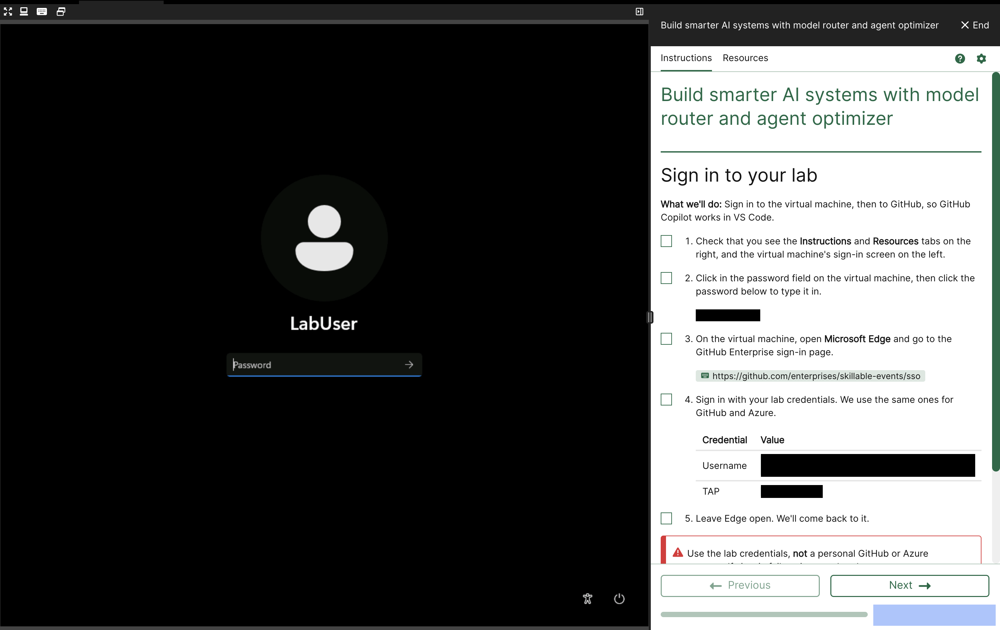
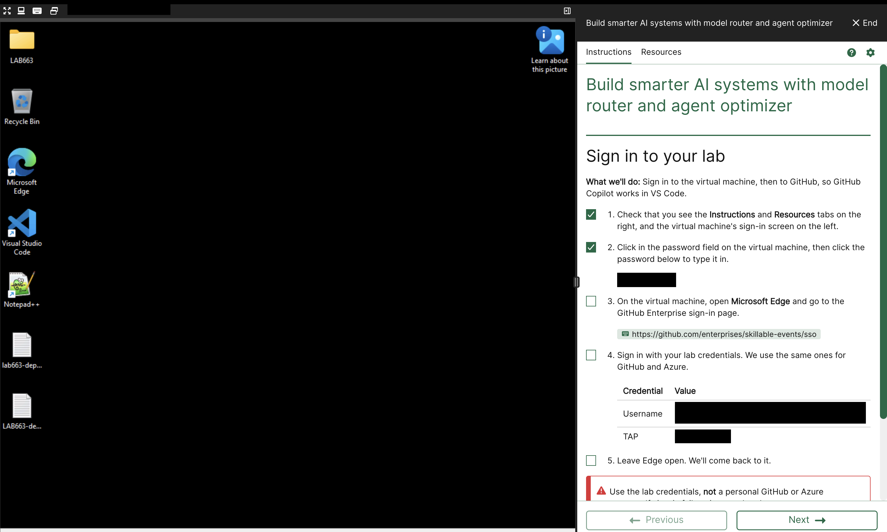
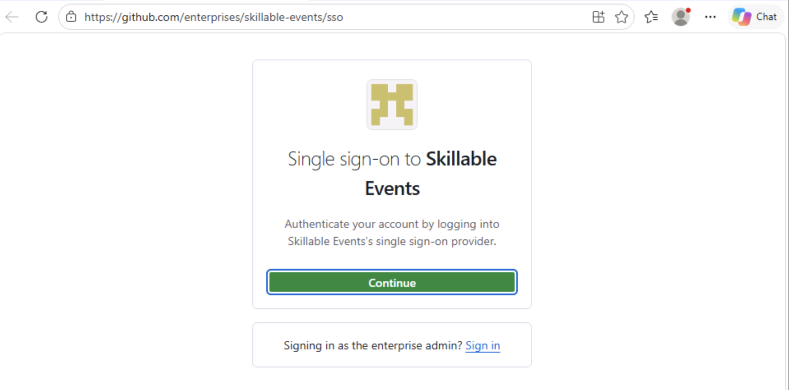
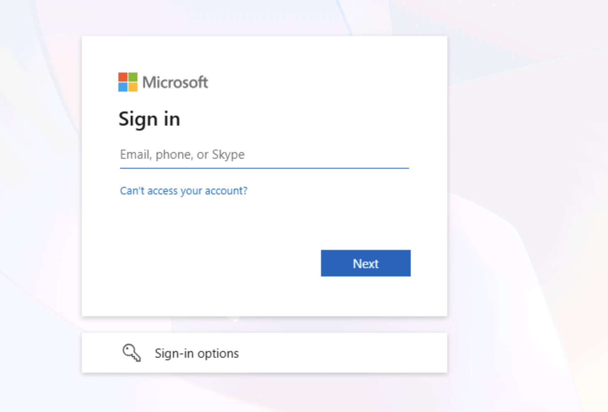
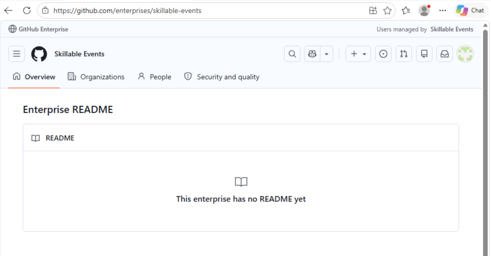
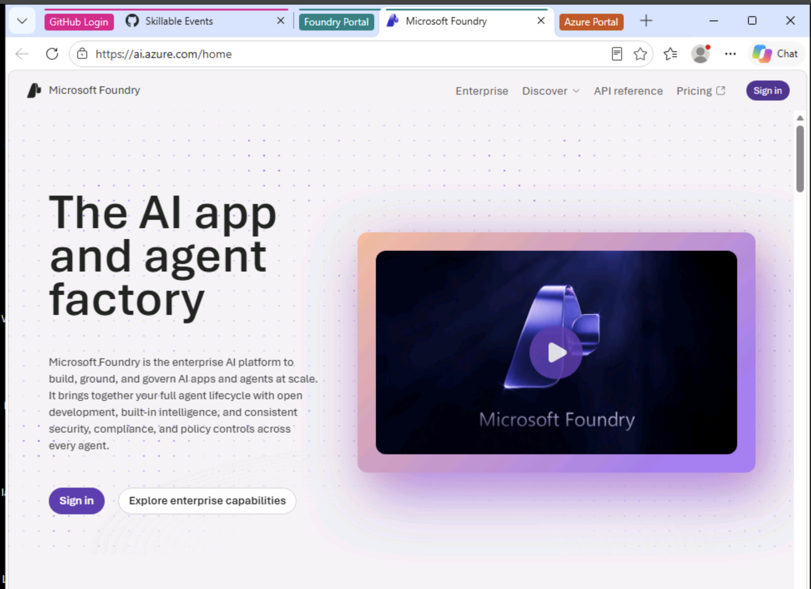
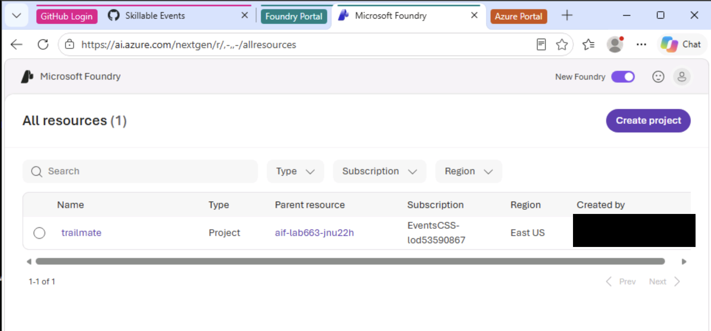
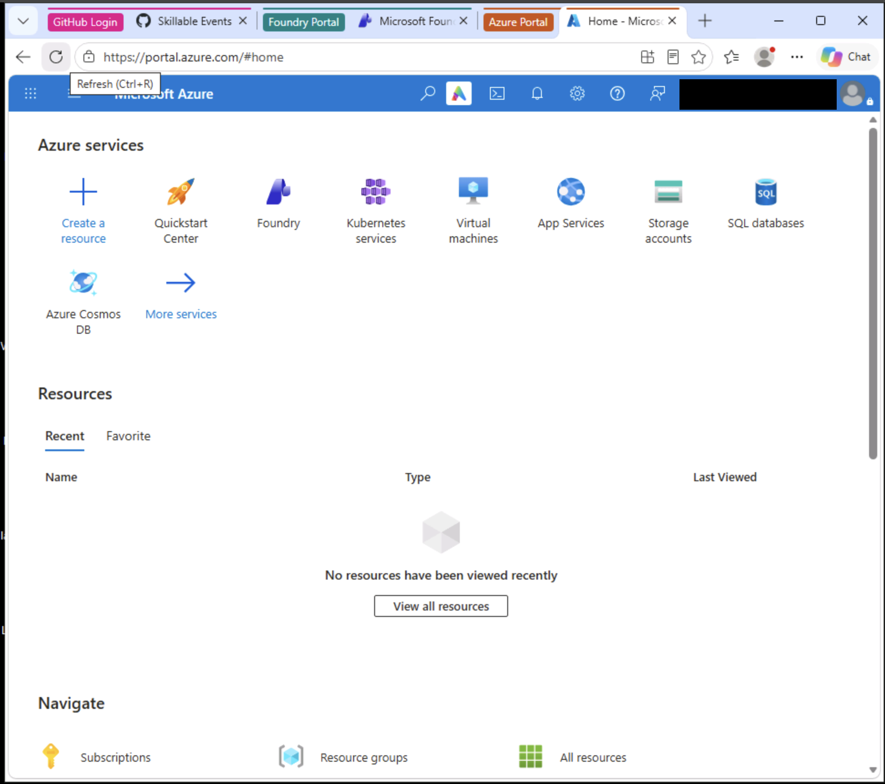
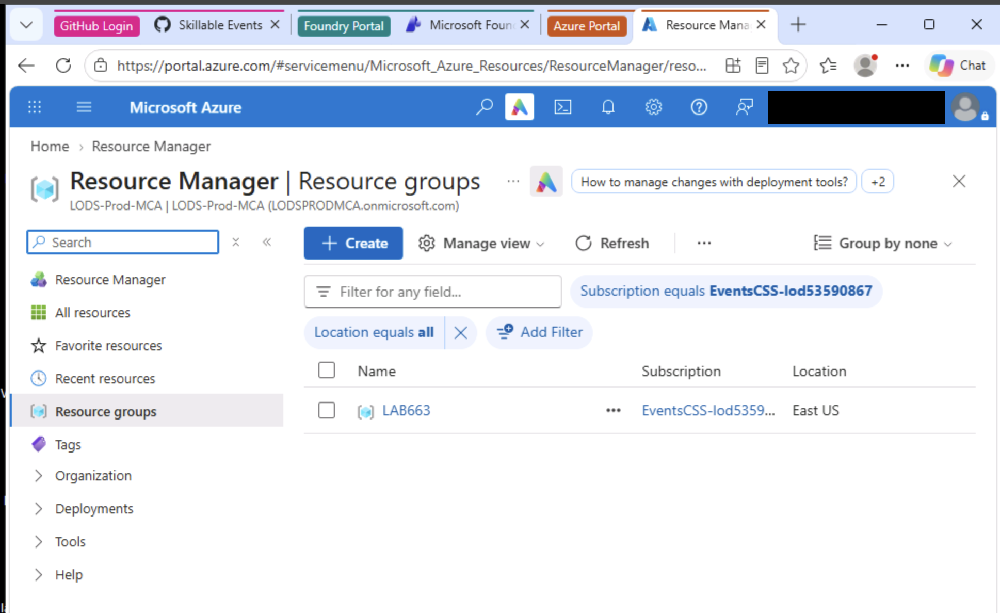

# 0.1 Welcome and sign in

**What we'll do:** Find out what this lab is about, then sign in to the virtual machine, GitHub, the Foundry portal, and the Azure portal, all with the lab credentials.

## About this lab

**Build smarter AI systems with model router and agent optimizer.** Getting a first agent working is the easy part. Keeping it accurate and affordable as real questions come in is harder. This lab is about that second part.

**The scenario.** TrailMate is a support agent for an outdoor-gear store. It answers customer questions from the store's product manuals. It works, but it sometimes overstates what a product can do, it answers questions that aren't its job, and it sends every question to the same model, whether the question is easy or hard.

**What we'll learn.** We improve TrailMate one change at a time and measure each change in Microsoft Foundry:

| Tool | What it does for us |
|:-----|:--------------------|
| Traces, evaluations, and insights | Show what the agent did and where it went wrong |
| A rubric evaluator | Scores answers against our own definition of a good TrailMate answer |
| Agent optimizer | Rewrites the agent's instructions and scores each candidate with our rubric |
| Model router | Picks a model for each question, so easy questions can use a cheaper model |

**How we apply it.** The same loop works for any agent we build: measure where we are, change one thing, compare the result, and keep the change only when the evidence says it helped. For the business, that means quality and cost we can show, not guess. For engineering, it means every change is small, measured, and easy to undo.

---

## Sign in to the virtual machine

1. [] Check that you see the **Instructions** and **Resources** tabs on the right, and the virtual machine's sign-in screen on the left. The blue bar at the bottom right shows the time left in the lab.

    

1. [] Click in the password field on the virtual machine, then click the password below to type it in.

    +++@lab.VirtualMachine(Win11-Pro-Base).Password+++

1. [] Check that the desktop appears, then tick the boxes for the steps you've done. Ticking boxes tracks our progress.

    

## Sign in to GitHub

1. [] Open **Microsoft Edge** and go to the GitHub Enterprise sign-in page. Select **Continue**.

    +++https://github.com/enterprises/skillable-events/sso+++

    

1. [] At the Microsoft sign-in, use these lab credentials, **not** your own account.

    | Credential | Value |
    |:-----------|:------|
    | Username | +++@lab.CloudPortalCredential(User1).Username+++ |
    | TAP | +++@lab.CloudPortalCredential(User1).AccessToken+++ |

    

1. [] Check that you see the **Skillable Events** enterprise page. Leave this tab open.

    

> [+Hint] I see an error instead
>
> The GitHub license may still be registering. Wait a few minutes and try again. If it still fails, raise your hand to ask a proctor for help.

## Sign in to the Foundry portal

1. [] Open a new tab, go to the Foundry portal, and select **Sign in**. It reuses the lab credentials.

    +++https://ai.azure.com+++

    

    > [!Hint] Edge may already have tab groups such as **GitHub Login**, **Foundry Portal**, and **Azure Portal**. Use them to keep your tabs tidy.

1. [] Check that **All resources** lists one project, **trailmate**. Leave this tab open.

    

## Sign in to the Azure portal

1. [] Open a new tab and go to the Azure portal. If it doesn't sign you in, select **Sign in** or refresh the page.

    +++https://portal.azure.com+++

    

1. [] Select **Resource groups** and check that **LAB663** is the only one listed. Leave this tab open.

    

---

> [!Note] **Success:** We just signed in to the virtual machine, GitHub, Foundry, and Azure with the lab credentials. Next, we set up our development environment.
