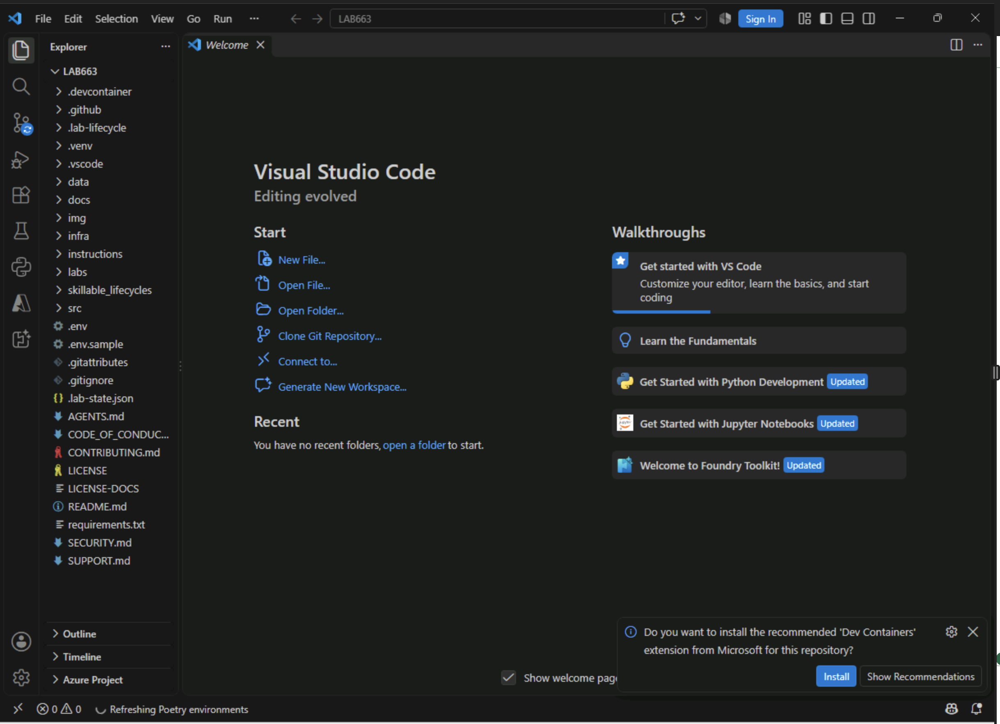
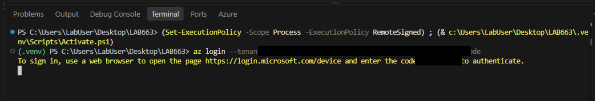
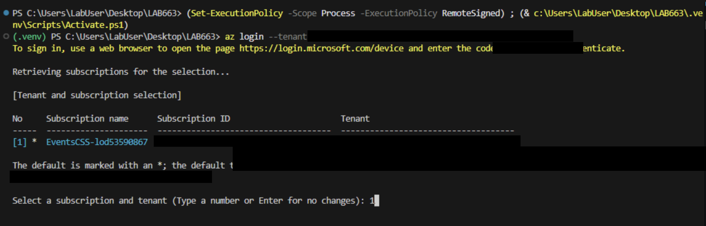

# 1.1 Set up the local environment

**What we'll do:** Open the lab in VS Code, check that our `.env` settings file is ready, and sign in to Azure.

## Open the lab in VS Code

1. [] Open **Visual Studio Code** from the desktop and check that the Explorer shows the **LAB663** folder. If a pop-up offers to install the **Dev Containers** extension, close it. If asked whether you trust the authors, select **Yes**.

    

1. [] In the Explorer, check that a **.env** file is listed near the bottom of the **LAB663** folder. The lab setup wrote it with our project's settings, and every notebook reads it. We don't need to open it.

    > [+Hint] I don't see .env
    >
    > The lab may still be preparing. Wait a few minutes and check the Explorer again. If it's still missing, raise your hand and ask a proctor for help.

1. [] Open a terminal with **Terminal > New Terminal**, or press **Ctrl+Shift+backtick**. If you don't see the **Terminal** menu, it's under **...** in the menu bar.

## Sign in to Azure

1. [] In the terminal, run this command. It prints a link and a code.

    ++az login --tenant @lab.CloudSubscription.TenantId --use-device-code++

    

1. [] Copy the code, then open the link in Edge and paste it. Pick the lab account you used on page 0.1.
1. [] When asked to approve the sign-in, select **Approve**. Then close the browser tab and return to VS Code.

    

1. [] In the terminal, type **1**, or press **Enter**, to keep the default subscription marked with **\***.

    

---

> [!Note] **Success:** We just opened the lab, confirmed our `.env` is ready, and signed in to Azure.
