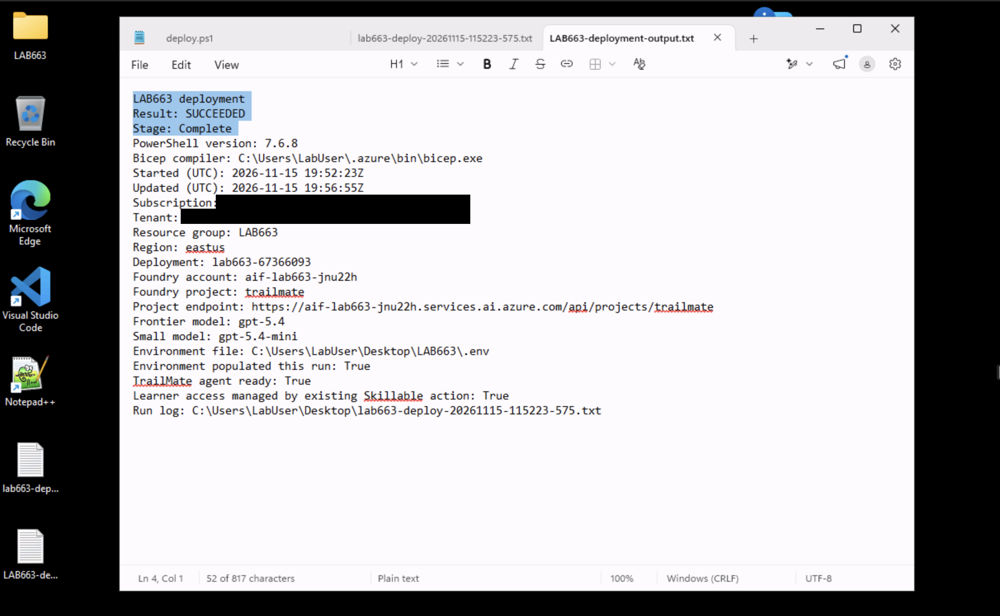
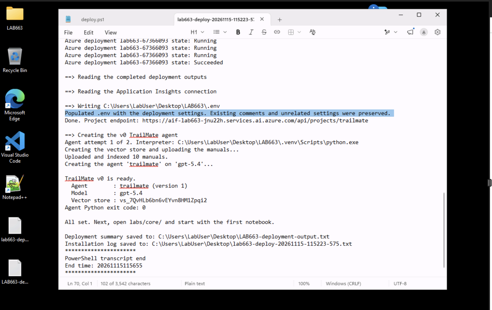
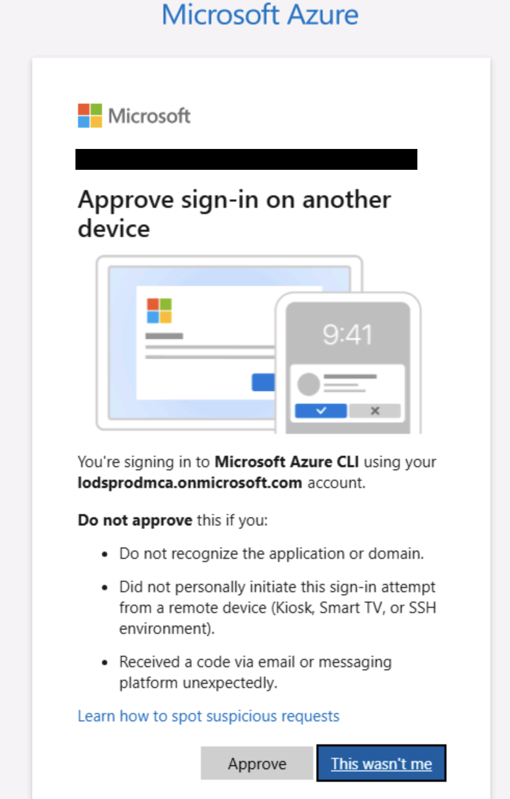

# 1.1 Set up the local environment

**What we'll do:** Confirm the lab deployed our Azure resources and set up our local `.env` file, open the lab in VS Code, and sign in to Azure.

## Check the environment status

The desktop has two text files: one starting with **LAB663** and one with **lab663**. Double-click each to open it in an editor.

1. [] Open **LAB663-deployment-output.txt**, the deployment summary. Check that it says **Result: SUCCEEDED**.

    

1. [] Open the **lab663-deploy-...** file, the run log. Find the line **Populated .env with the deployment settings**.

    

> [+Hint] It says RUNNING or FAILED
>
> **RUNNING:** the lab is still preparing. Wait a few minutes and open the file again. **FAILED:** don't continue. Raise your hand and share the **Stage** line.

## Open the lab in VS Code

1. [] Open **Visual Studio Code** from the desktop and check that the Explorer shows the **LAB663** folder. If a pop-up offers to install the **Dev Containers** extension, close it. If asked whether you trust the authors, select **Yes**.

    

1. [] Open a terminal with **Terminal > New Terminal**, or press **Ctrl+Shift+backtick**. If you don't see the **Terminal** menu, it's under **...** in the menu bar.

## Sign in to Azure

1. [] In the terminal, run this command. It prints a link and a code.

    ++az login --tenant @lab.CloudSubscription.TenantId --use-device-code++

    

1. [] Copy the code, then open the link in Edge and paste it. Pick the lab account you used on page 0.1.
1. [] When asked to approve the sign-in, select **Approve**. Then close the browser tab and return to VS Code.

    

1. [] In the terminal, type **1**, or press **Enter**, to keep the default subscription marked with **\***.

    

---

> [!Note] **Success:** We just confirmed our resources and `.env` are ready, opened the lab, and signed in to Azure.
