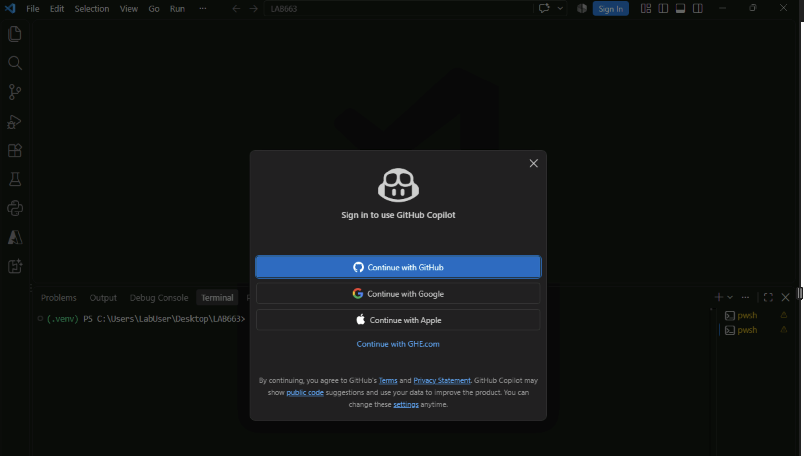
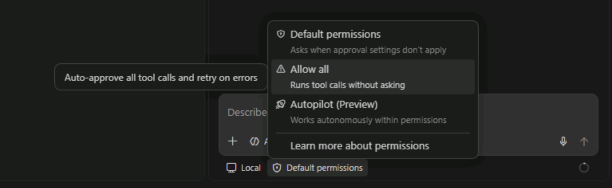
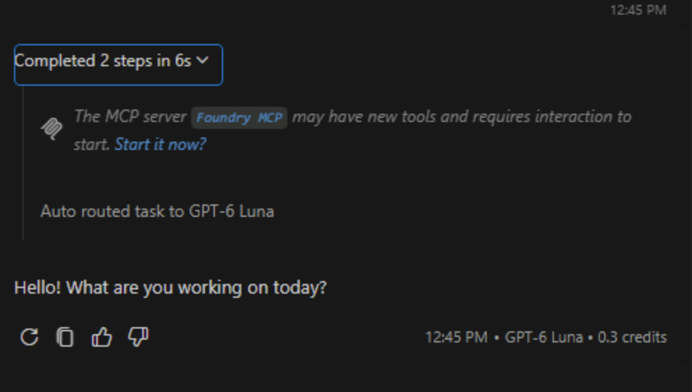
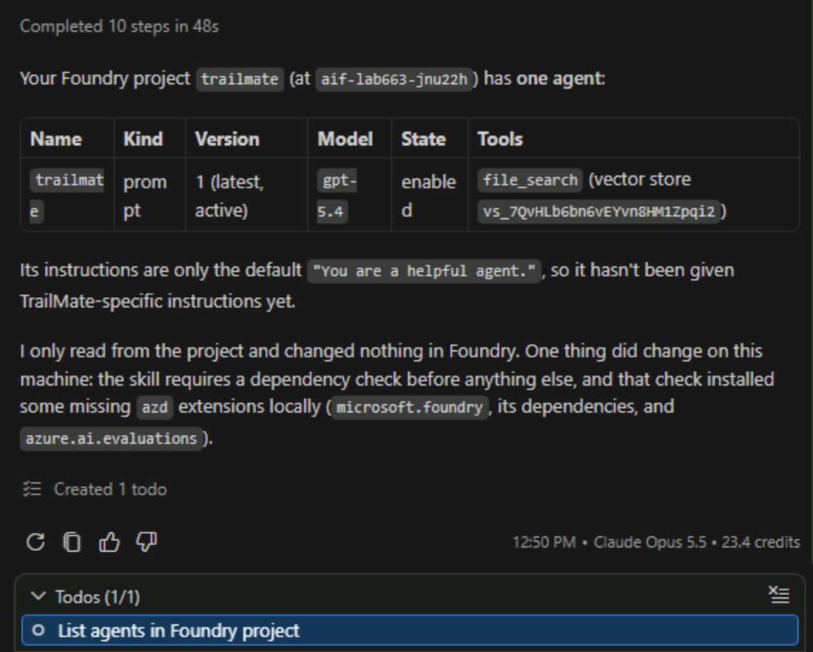

# 1.2 Set up GitHub Copilot Chat

**What we'll do:** Sign in to GitHub Copilot in VS Code, connect it to Foundry, and check it can see our project.

## Sign in to GitHub Copilot

1. [] In VS Code, click the blue **Sign in** button in the top bar, then select **Continue with GitHub**.

    

1. [] In the browser, select **Continue**, then authorize **Visual Studio Code**.
1. [] When the browser offers to open VS Code, select **Open**, or just switch back to VS Code.
1. [] Check that the profile icon at the bottom left shows your GitHub sign-in.

## Get Copilot Chat ready

1. [] In the Copilot Chat window, send just this message and wait for a reply.

    ++Hello++

1. [] In the chat box, switch the model to **Claude Opus 5.5**.
1. [] Switch **Default permissions** to **Allow all**, so Copilot doesn't stop to ask before each tool call. Select **Enable** when asked to confirm.

    

## Connect Copilot to Foundry

1. [] Above Copilot's reply, click **Completed 2 steps** to expand it, then click **Start it now?** next to **Foundry MCP**.

    

1. [] Select **Allow**, then **Work or school account**.
1. [] Sign in with the lab credentials. Select **Yes** to stay signed in, and wait until the device is confirmed.

    | Credential | Value |
    |:-----------|:------|
    | Username | +++@lab.CloudPortalCredential(User1).Username+++ |
    | TAP | +++@lab.CloudPortalCredential(User1).AccessToken+++ |

## Check Copilot can reach Foundry

1. [] Send this message. It takes up to a minute while Copilot installs anything missing.

    ++/microsoft-foundry List the agents in my Foundry project. Do not change anything.++

1. [] Check that the reply lists the **trailmate** agent.

    

> [+Hint] Copilot shows an error
>
> If you see a license or access error, check that you signed in with the lab account, not a personal one. If it persists, raise your hand. The license server can take a few minutes to start.

---

> [!Note] **Success:** We just set up GitHub Copilot Chat. It can explain things and talk to our Foundry project whenever we get stuck.
