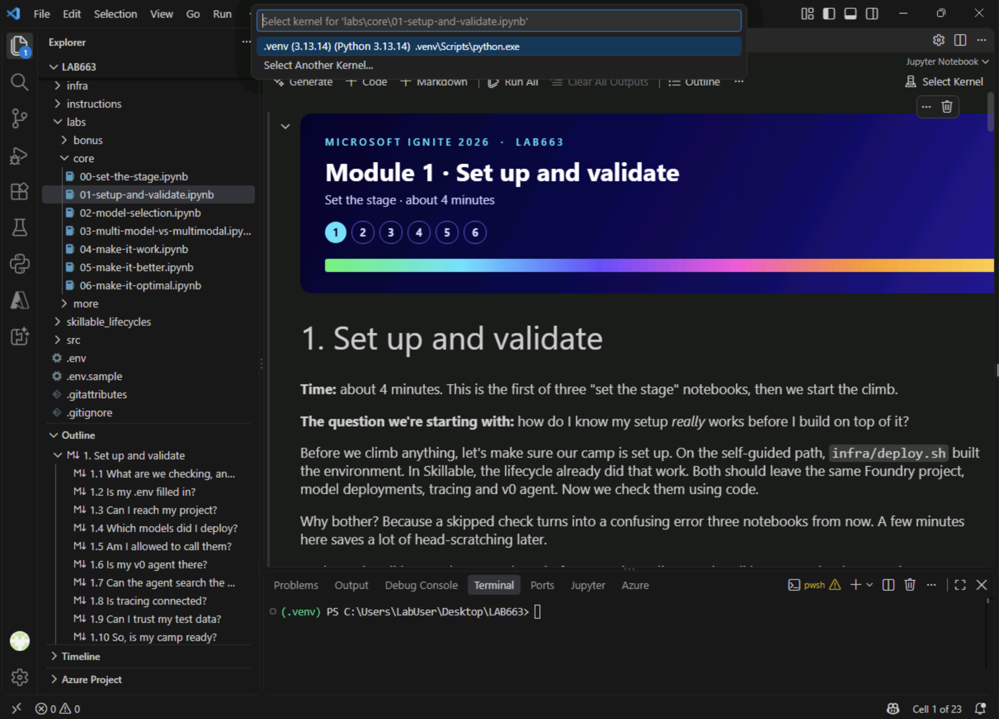
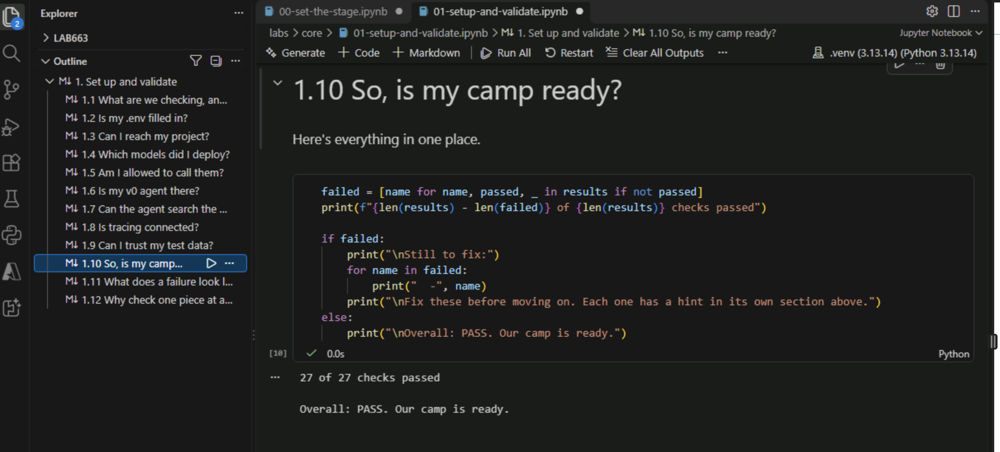

# 1.3 Validate the Azure environment

**What we'll do:** Run one notebook that checks every part of the setup, so any failure points at exactly one fix.

1. [] In the VS Code **Explorer**, open **labs > core** and select **01-setup-and-validate.ipynb**.
1. [] Expand **Outline** at the bottom of the Explorer. It lists the notebook's numbered sections, so we can jump between them.
1. [] Click **Select Kernel** at the top right, then **Python Environments**, and pick **.venv (3.13.14)**. We do this for every notebook we open.

    

1. [] Click **Run All** at the top of the notebook.
1. [] In the Outline, click **1.10 So, is my camp ready?** and wait there until it prints **Overall: PASS. Our camp is ready.** This takes a minute or two.

    

> [!Knowledge] The "Error we expected" line in section 1.11 is there on purpose. It shows what a failure looks like.

> [+Hint] A check failed
>
> New role assignments can take up to 10 minutes. Wait, then rerun the failed cell. To understand the error, paste this into Copilot Chat with the message:
>
> ++In notebook 01, this check failed with the message below. What does it mean, and what should I try? Don't change any files.++

> [+Hint] Ask Copilot: what did we check?
>
> ++Summarize what labs/core/01-setup-and-validate.ipynb checked, in three bullets. Don't change any files.++

---

> [!Note] **Success:** We just proved our project, models, router editions, agent, and tracing all work under our lab account.
