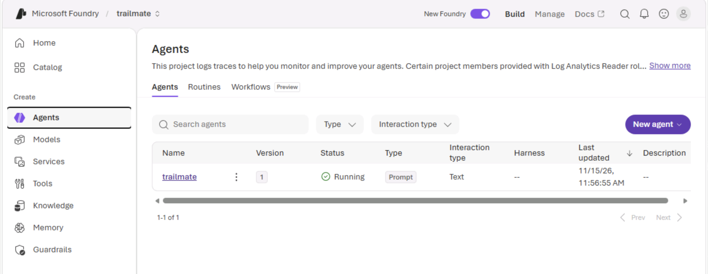
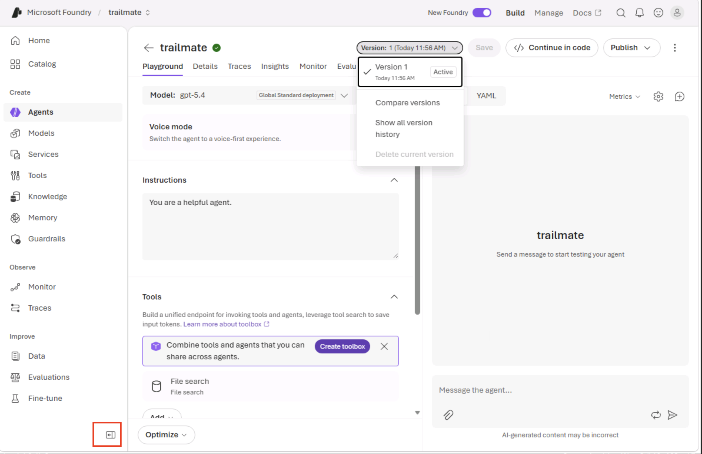
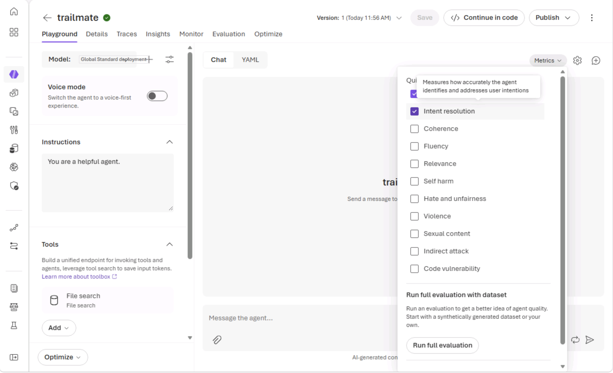

# 2.1 Meet TrailMate v0

**What we'll do:** Meet the agent we'll improve today. TrailMate is already deployed in Foundry. Let's see what it's made of.

1. [] In Edge, switch to the **Foundry portal** tab. In the left menu, select **Agents**. You see one agent, **trailmate**.

    

1. [] Select **trailmate** to open its playground, then look at the left side:
    - **Version 1** is selected. That's the agent version deployed in Foundry, which we call **v0**, the baseline for our climb.
    - The **Model** is **gpt-5.4**, a large frontier model.
    - The **Instructions** are just one line: "You are a helpful agent."
    - **File search** under **Tools** lets it search ten product manuals.

1. [] To make room for the chat, collapse the left menu with the button at its bottom left, highlighted in red.

    

1. [] Open **Metrics** at the top right of the chat and turn on the evaluators you want. The playground now scores every answer for us.

    

> [+Hint] Ask Copilot: what is this agent?
>
> ++What is a prompt agent in Microsoft Foundry, and what does its file search tool do? Answer in two sentences.++

---

> [!Note] **Success:** We just met TrailMate v0: one model, one tool, and one line of instructions, with live evaluation turned on.
