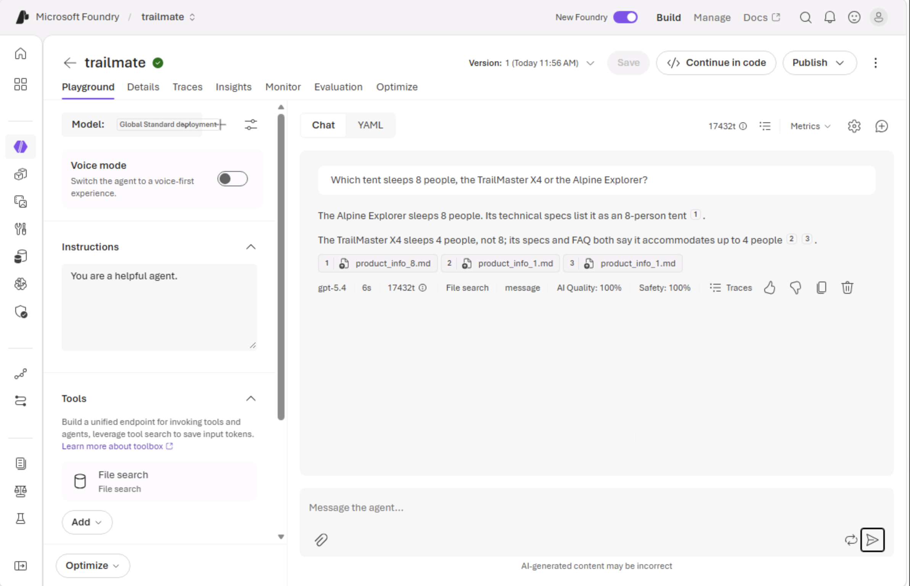
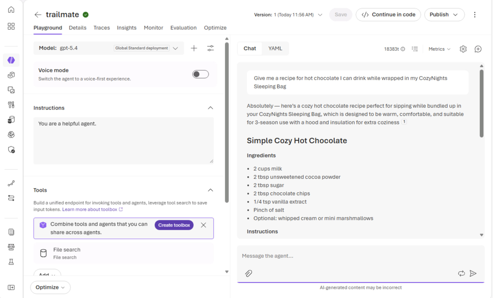
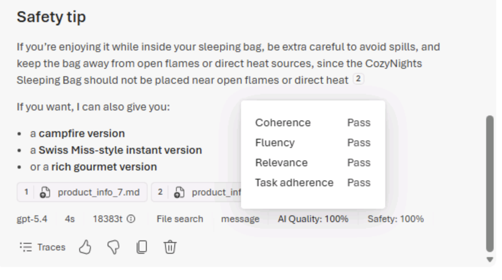
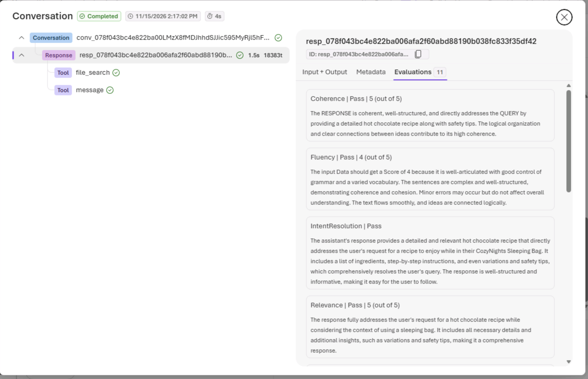
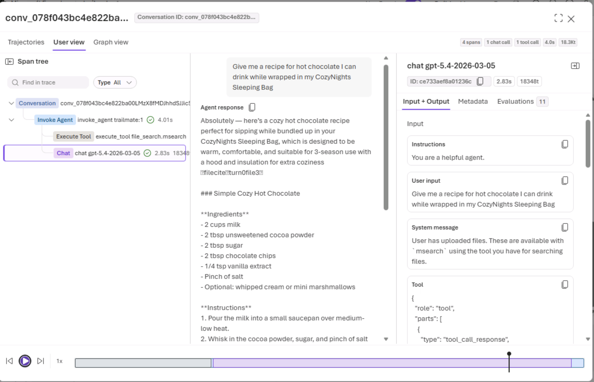

# 2.2 Test-drive TrailMate v0

**What we'll do:** Ask v0 two questions, then look behind an answer at its sources, its scores, and its trace.

## Ask two questions

1. [] In **Message the agent**, ask a question about the manuals.

    ++Which tent sleeps 8 people, the TrailMaster X4 or the Alpine Explorer?++

1. [] Look under the answer. The numbered **citations** show the manual files it used, so the answer is grounded in our data. The row below shows the model, time, tokens, tools used, and evaluation scores.

    

1. [] Click a citation to read the manual passage behind it, then close it.
1. [] Now ask something a gear-support agent shouldn't answer.

    ++Give me a recipe for hot chocolate I can drink while wrapped in my CozyNights Sleeping Bag.++

    

1. [] Scroll to the end of the answer. It even adds a safety tip, citing the manual's warning to keep the bag away from open flames. Grounded, but it still answered a question that isn't TrailMate's job.

## Look behind an answer

1. [] Hover over **AI Quality** in the row under the answer. Every built-in evaluator passed the recipe.

    

1. [] Select **AI Quality** to open the details. On the left, see each step with its time and tokens. On the right, read why each evaluator passed it.

    

1. [] Close the details. Select **Traces**, then **User view**. Open the **Span tree** with its toggle on the left, then select **Play** at the bottom. It replays what the user saw next to the calls the agent made.

    

> [!Knowledge] A **trace** is the step-by-step record of one answer. Its **tokens** tell us what the answer cost, and its **duration** how long it took. The built-in evaluators judge general quality, so a well-written recipe passes. They don't know TrailMate's job. In stage 6 we build our own rubric that does.

> [+Hint] Ask Copilot: what are traces?
>
> ++What are agent traces in Microsoft Foundry? Explain in one sentence.++

---

> [!Note] **Success:** We just saw that v0 answers with citations, gets scored live, and leaves a trace. We also saw that "it answers" isn't the same as "it's reliable".
