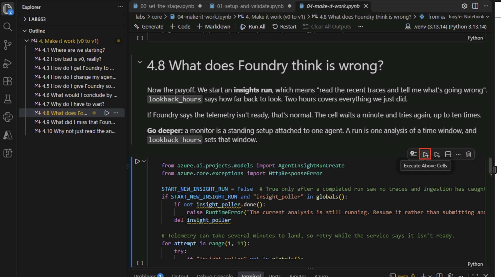
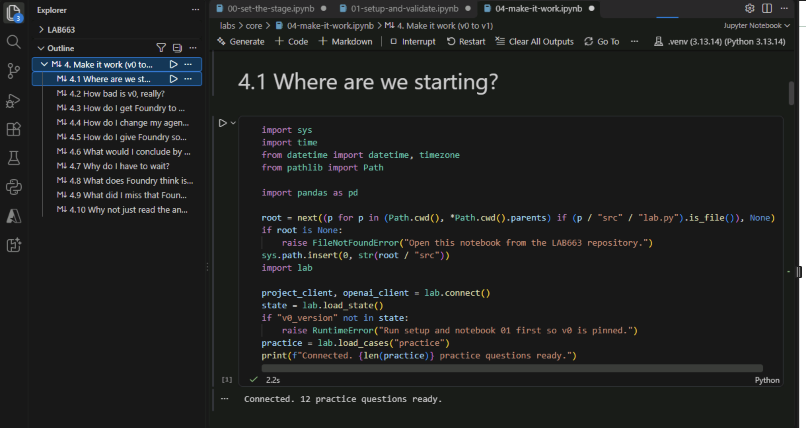
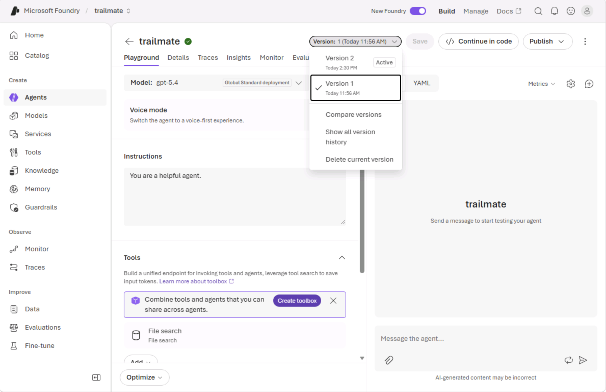
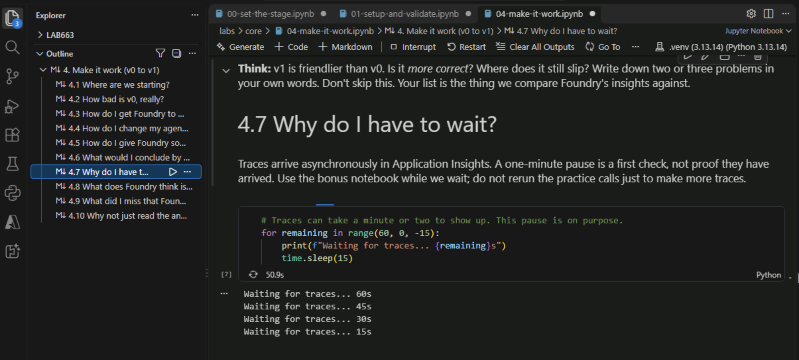
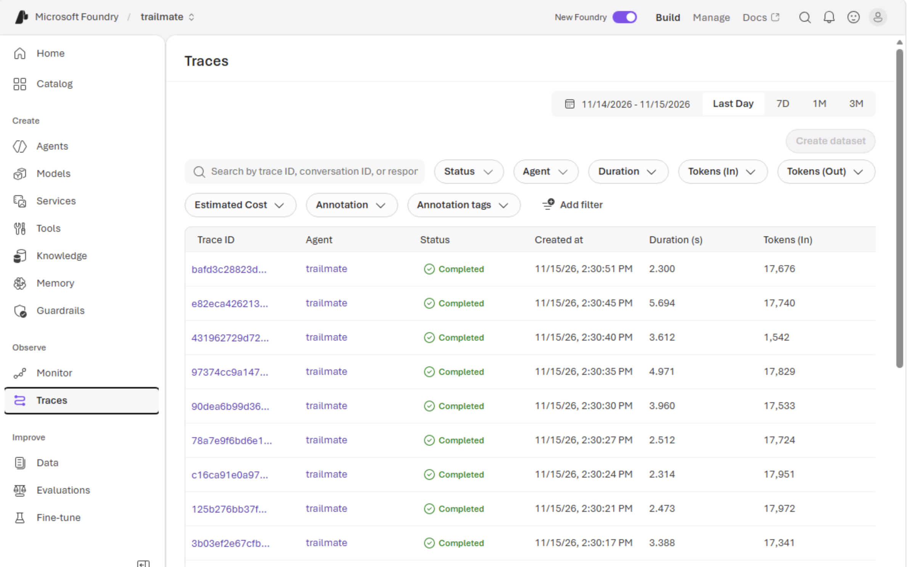

# 3.1 Create Version 2

**What we'll do:** Change one lever, the instructions, to create TrailMate agent **Version 2**, then ask it 12 practice questions so it leaves traces for Foundry to analyze. The optimizer on the next page learns from these.

1. [] Close the Copilot Chat pane to make room for the notebook: click the **chat icon** in the top bar, next to the search box. Click it again any time to reopen the chat.
1. [] In the Explorer, open **labs > core > 04-make-it-work.ipynb**.
1. [] Select the **.venv (3.13.14)** kernel, the same way as on page 1.3.
1. [] In the **Outline**, click **4.8 What does Foundry think is wrong?**, then click the first code cell below that heading.
1. [] Hover over that cell and click the **Execute Above Cells** icon in its toolbar. This runs sections 4.1 to 4.7 in order and stops before 4.8.

    

1. [] Use the Outline to follow along. The first cell prints **Connected. 12 practice questions ready.**, and section **4.4** prints **Saved. TrailMate v1 is Foundry version 2**. The notebook calls it v1; in the portal it's **Version 2**.

    

1. [] This is the moment **trailmate** moves to agent **Version 2**. Switch to the Foundry portal tab and refresh the page (**F5**) so it loads the new version. Then open the **Version** menu at the top of the trailmate playground. **Version 2** is now **Active**, and Version 1, our baseline, is still listed below it.

    

1. [] Wait for section **4.7** to count down. It pauses one minute so the traces can arrive. The whole run takes a couple of minutes.

    

1. [] While it waits, switch to the Foundry portal. Expand the left menu with its toggle at the bottom left, then select **Traces**. The 12 practice conversations appear one by one, each with its duration and tokens.

    

> [+Hint] OPTIONAL - Ask Copilot: what just ran?
>
> ++Summarize what sections 4.1 to 4.7 of labs/core/04-make-it-work.ipynb did, in three bullets. Don't change any files.++

---

> [!Note] **Success:** We just finished **Make it work** (notebook 04): agent Version 2 is created, and Foundry has 12 conversations' worth of traces to learn from.
