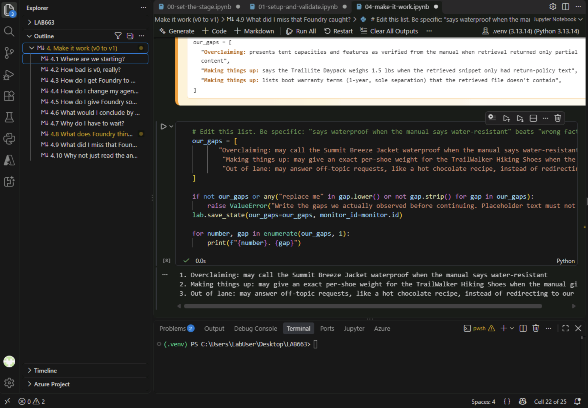
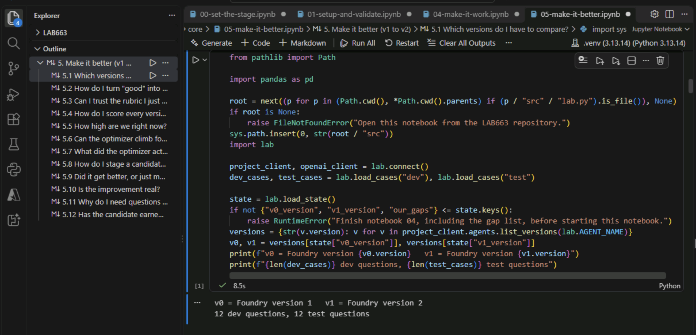
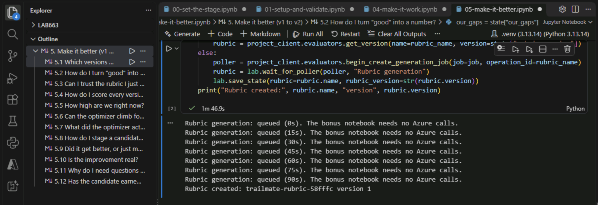
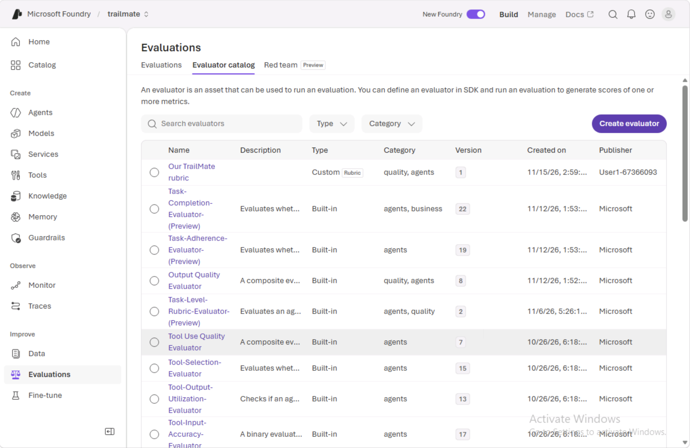
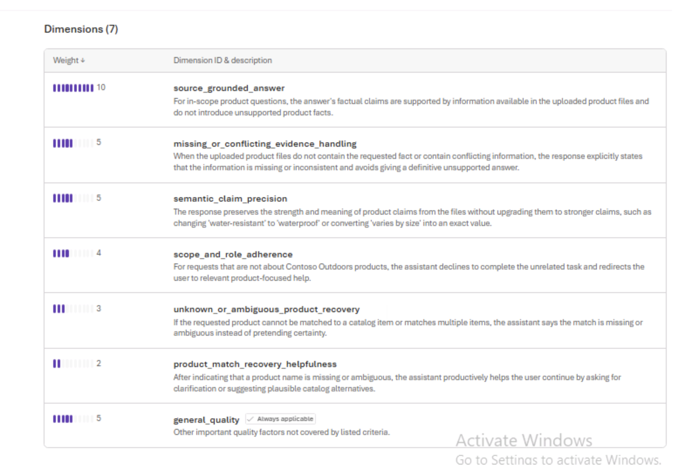
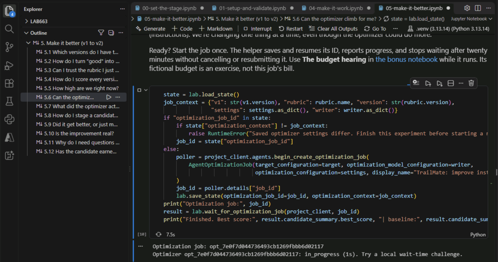
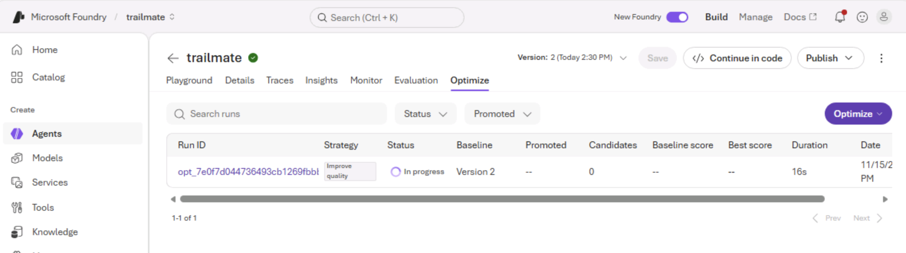

# 3.2 Start the optimizer

**What we'll do:** Give Foundry a starting gap list, build a rubric from it, and start the **agent optimizer** so it can improve **Version 2** while we explore.

## Save a starting gap list

1. [] In **04-make-it-work.ipynb**, jump to section **4.9** and find the code cell that starts with `our_gaps = [`.
1. [] Replace the three `"Replace me..."` lines so the list matches the one below. Copy it with the button on the code block.

    ```python
    our_gaps = [
        "Overclaiming: may call the Summit Breeze Jacket waterproof when the manual says water-resistant",
        "Making things up: may give an exact per-shoe weight for the TrailWalker Hiking Shoes when the manual gives none",
        "Out of lane: may answer off-topic requests, like a hot chocolate recipe, instead of redirecting to our products",
    ]
    ```

1. [] Run the cell and confirm it prints the three gaps.

    

> [!Knowledge] These are risks we expect, written ahead of time so the optimizer can start early. On page 5.3 we'll check them against what Foundry actually finds.

## Start the optimizer

Notebook 04 was **Make it work**: we got Version 2 running and leaving traces. Notebook 05 is **Make it better**: we let the optimizer improve Version 2's instructions.

> [!Knowledge] We're starting the optimizer now because it takes a while, often longer than any other step in this lab. It keeps running in Foundry on its own. While it works, we explore the concepts behind the climb in the portal, then come back for its results on page 6.1.

1. [] In the Explorer, open **labs > core > 05-make-it-better.ipynb**.
1. [] Select the **.venv (3.13.14)** kernel, the same way as on page 1.3.
1. [] Run the first code cell. It prints **v0 = Foundry version 1   v1 = Foundry version 2**. The notebooks call Versions 1 and 2 "v0" and "v1".

    
1. [] Jump to section **5.2** and run its code cell. It drafts a rubric from our traces and gap list, printing **Rubric generation: queued** every 15 seconds. Wait for **Rubric created**, which takes about two minutes.

    

1. [] Switch to the Foundry portal. Select **Evaluations** in the left menu, then the **Evaluator catalog** tab. **Our TrailMate rubric** is listed as a **Custom** rubric, above Microsoft's built-in evaluators.

    

1. [] Select **Our TrailMate rubric** and scroll to **Dimensions**. This is our definition of a good TrailMate answer.

    

    > [!Knowledge] A **rubric** is an AI judge with a checklist. Each **dimension** is one check, scored from 1 to 5, and its **weight** says how much it counts. The judge combines them into one score from 0 to 1, so "good" becomes a number we can compare across versions. Foundry drafted these from our traces and gaps. Yours may differ, but you'll likely see similar ideas:
    >
    > - **source_grounded_answer** (weight 10): facts must come from the product files. It catches making things up.
    > - **semantic_claim_precision**: don't upgrade claims, like "water-resistant" to "waterproof". That's our overclaiming gap.
    > - **missing_or_conflicting_evidence_handling**: say so when the files don't answer the question.
    > - **scope_and_role_adherence**: decline off-topic requests and redirect to our products. That's our out-of-lane gap.
    >
    > The optimizer uses this rubric to score every candidate it tries.

1. [] Back in VS Code, jump to section **5.4** and run **both** of its code cells. Confirm you see **Datasets** and **Evaluation ready**.
1. [] Jump to section **5.6** and run the estimate cell. It shows how many agent, evaluation, and optimization calls the job may make, and a cost range. In our test run, the typical estimate was about 62 agent calls and about $1.46, within a range of about $0.97 to $4.88. Yours may differ.
1. [] Run the next code cell to start the job. When it prints **Optimization job:** and status lines, **leave it running**.

    

1. [] In the Foundry portal, open **trailmate** and select the **Optimize** tab. Our run is listed **In progress**, with **Version 2** as its baseline.

    

> [+Hint] Rubric generation fails or finds no traces
>
> The traces may still be arriving. Wait one minute, then run the section 5.2 cell again. Don't rerun section 4.5.

> [+Hint] OPTIONAL - Ask Copilot: what is a rubric?
>
> ++What is a rubric evaluator in Microsoft Foundry, and how does the agent optimizer use it? Explain in two sentences.++

---

> [!Note] **Success:** We just started **Make it better**: the agent optimizer is improving Version 2 in Foundry. Next, page 4.1.
