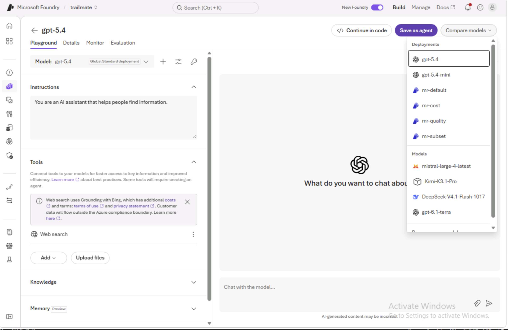
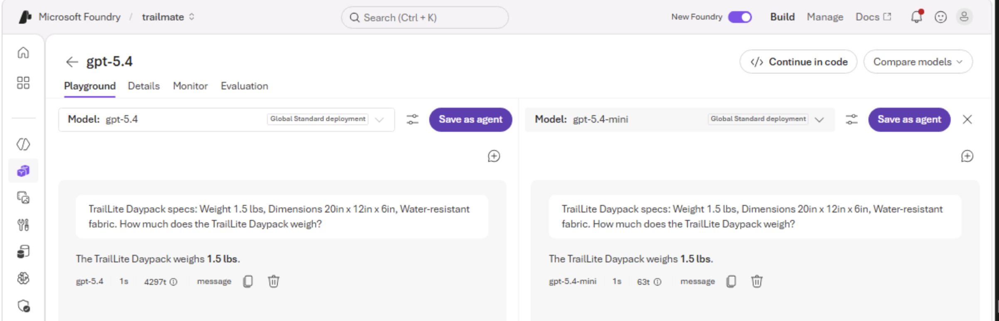
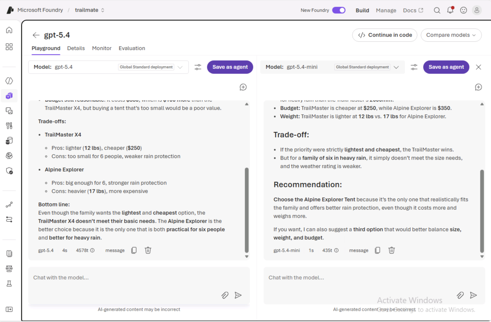

# 4.2 Compare a big and a small model

**What we'll do:** While the optimizer and insights work, let's learn the ideas behind the climb. First, send the same two questions to a big and a small model, and see how model choice changes speed, tokens, and quality.

1. [] In the Foundry portal, select **Models** in the left menu, then **gpt-5.4**. Its playground opens.

    > [!Note] Here we test the **models** directly, not the TrailMate agent. There's no file search, so each question includes the product facts it needs.

1. [] Open **Compare models** at the top right and select **gpt-5.4-mini**. The two models now sit side by side, and a message goes to both.

    

1. [] Send this easy question.

    ++TrailLite Daypack specs: Weight 1.5 lbs, Dimensions 20in x 12in x 6in, Water-resistant fabric. How much does the TrailLite Daypack weigh?++

1. [] Compare the row under each answer. Both are right in about a second, but look at the token counts.

    

1. [] Send this harder question, with a trap: one TrailMaster X4 can't sleep six.

    ++TrailMaster X4 Tent: 4-person, 12 lbs, $250, rainfly rated 2000mm. Alpine Explorer Tent: 8-person, 17 lbs, $350, rainfly rated 3000mm. A family of six is camping in heavy rain, wants the lightest setup possible, and has a tight budget. Weigh the trade-offs and recommend one.++

1. [] Scroll to the end of both answers and compare the recommendation, the time, and the tokens.

    

> [!Knowledge] In our test, both models picked the Alpine Explorer, but the small one was faster and used a fraction of the tokens. The real question isn't "which model is best?" but "which questions need the big one?"

> [+Hint] Ask Copilot: big or small model?
>
> ++When should I pick gpt-5.4-mini over gpt-5.4? Answer in two sentences.++

---

> [!Note] **Success:** We just saw that a smaller model can give the same answer faster and with far fewer tokens, at least on these two questions.
