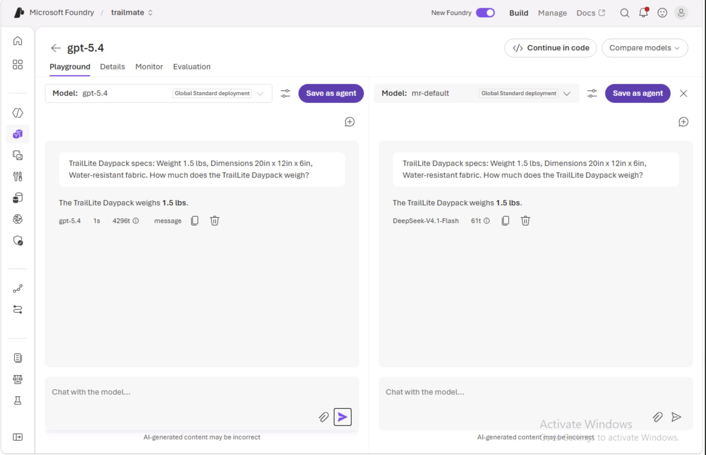
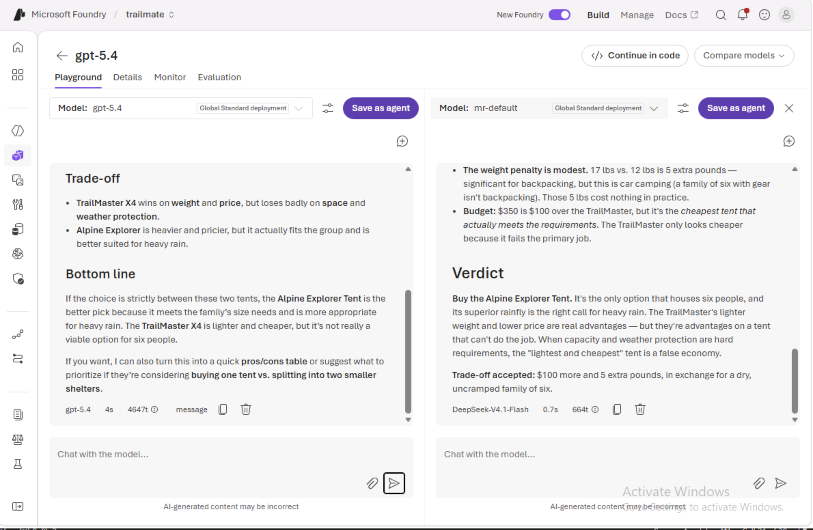
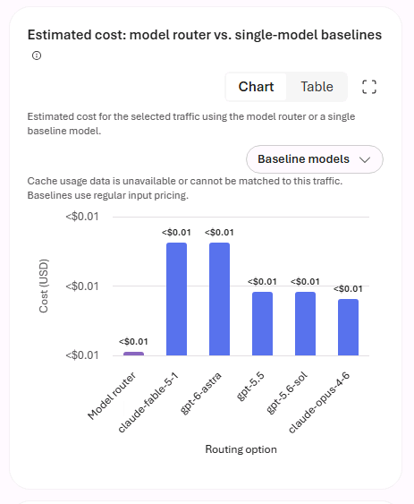

# 4.3 Let a router choose

**What we'll do:** Send the same two questions to **gpt-5.4** and to a **model router**, and see which model the router picks for each.

> [!Knowledge] A **model router** is one deployment that looks at each request and sends it to a model from a pool. Easy work can go to a small model, and hard work to a bigger one.

1. [] Clear both panes to start fresh conversations: select the **+** (new chat) icon at the top of each pane.
1. [] In the right pane, open the **Model** menu and switch **gpt-5.4-mini** to **mr-default**. Keep **gpt-5.4** on the left.
1. [] Send the easy daypack question again.

    ++TrailLite Daypack specs: Weight 1.5 lbs, Dimensions 20in x 12in x 6in, Water-resistant fabric. How much does the TrailLite Daypack weigh?++

1. [] Look at the row under the router's answer. It names the model the router chose, here **DeepSeek-V4.1-Flash**, a small, fast model.

    

1. [] Send the harder tent question and compare the two answers, times, and tokens.

    ++TrailMaster X4 Tent: 4-person, 12 lbs, $250, rainfly rated 2000mm. Alpine Explorer Tent: 8-person, 17 lbs, $350, rainfly rated 3000mm. A family of six is camping in heavy rain, wants the lightest setup possible, and has a tight budget. Weigh the trade-offs and recommend one.++

    

1. [] Now compare cost in dollars. In the left menu, select **Models**, then **mr-default**. Open the **Monitor** tab and scroll down to **Estimated cost: model router vs. single-model baselines**. Use **Baseline models** to pick which models to compare against.

    

    > [!Knowledge] This chart prices the same traffic in **dollars**, not tokens. A router can sometimes use more tokens and still cost less, because it sends much of the work to cheaper models, so its average cost per token is lower. Our test traffic was tiny, so every bar shows under one cent, but the bar heights show the gap.

> [!Note] Routers pick per request, so yours may choose a different model. In our test, the default router sent both questions to the small model and still got both right.

> [+Hint] OPTIONAL - Ask Copilot: how does a router choose?
>
> ++How does Microsoft Foundry model router decide which model answers a request? Explain in two sentences.++

---

> [!Note] **Success:** We just watched one deployment pick a model per question, and match gpt-5.4's answers for a fraction of the tokens.
