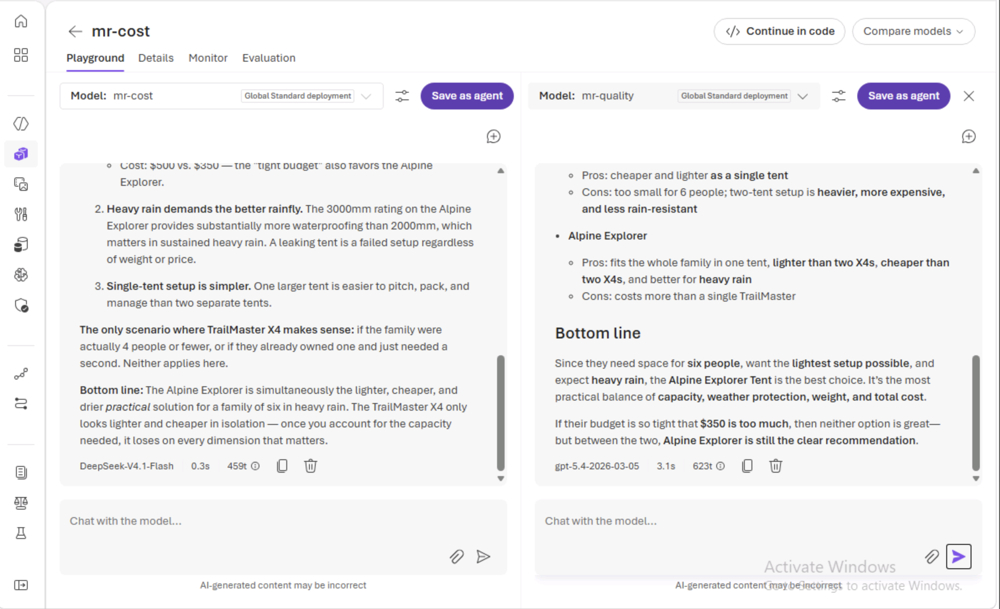

# 4.4 Turn the cost-quality dial

**What we'll do:** Send the hard question to a router in **cost** mode and one in **quality** mode, and compare their choices.

1. [] In the left pane, open the **Model** menu and select **mr-cost**. In the right pane, select **mr-quality**.
1. [] Send the tent question.

    ++TrailMaster X4 Tent: 4-person, 12 lbs, $250, rainfly rated 2000mm. Alpine Explorer Tent: 8-person, 17 lbs, $350, rainfly rated 3000mm. A family of six is camping in heavy rain, wants the lightest setup possible, and has a tight budget. Weigh the trade-offs and recommend one.++

1. [] Scroll to the end of both answers. Note which model each router picked, and check that both recommend the Alpine Explorer.

    

> [!Knowledge] In our test, cost mode picked **DeepSeek-V4.1-Flash**, a small, fast, and cheap model, and quality mode picked **gpt-5.4**, a frontier model. Both gave the same recommendation. With gpt-5.4, we paid more and waited longer for frontier quality this question didn't need. The routing mode is a dial between cost and quality. A cheaper pick only wins if the answer stays right across many questions, and that's what we measure on page 7.3.

> [+Hint] OPTIONAL - Ask Copilot: cost or quality mode?
>
> ++What is the difference between the cost and quality routing modes in Microsoft Foundry model router? Explain in one sentence.++

---

> [!Note] **Success:** We just saw how one setting shifts a router between cheaper and stronger models.
