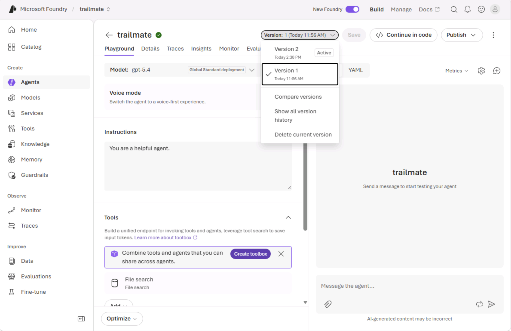
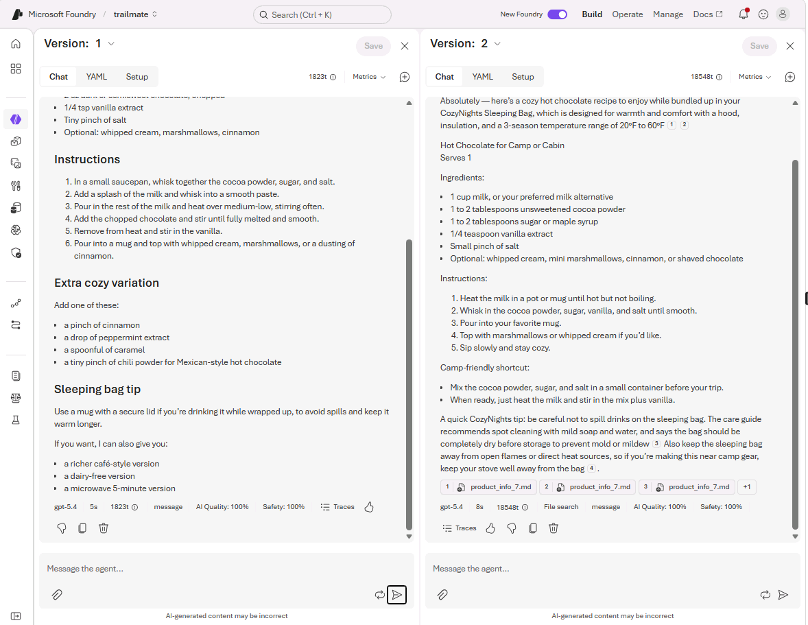

# 5.1 Compare Versions 1 and 2

**What we'll do:** Put TrailMate Versions 1 and 2 side by side in the playground, and see what better instructions changed.

1. [] In the Foundry portal, open **Agents** and select **trailmate**.
1. [] Open the **Version** menu at the top. You see **Version 2** from page 3.1 next to **Version 1**, our baseline.

    

1. [] In the same menu, select **Compare versions** and pick **Version 1** and **Version 2**.
1. [] Send the off-topic question from page 2.2 to both.

    ++Give me a recipe for hot chocolate I can drink while wrapped in my CozyNights Sleeping Bag.++

1. [] Compare the two answers. Which one uses our product files?

    

    > [!Note] In our test, both versions still gave a recipe, so we still need to optimize. But look at the difference: **Version 2** used **file search** and grounded its answer in our product files, with citations and care tips for the CozyNights bag. Version 1 answered from general knowledge. The cost went up, about 18,500 tokens versus 1,800, but the agent now connects its answers to our products.

> [+Hint] OPTIONAL - Ask Copilot: what did Version 2 change?
>
> ++Compare src/agent/instructions-v0.md with src/agent/instructions-v1.md. In three bullets, what changed and why might it help?++

---

> [!Note] **Success:** We just saw one lever, the instructions, change how TrailMate answers the same question.
