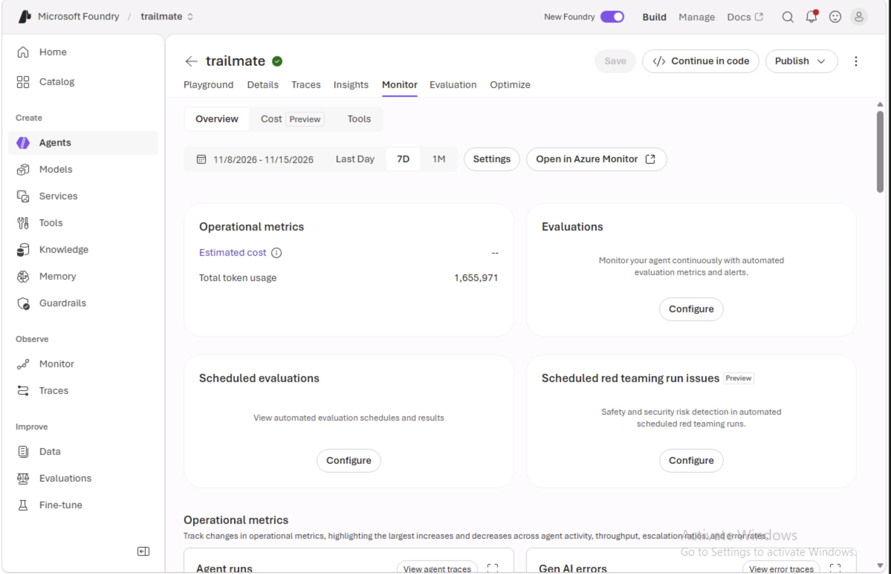
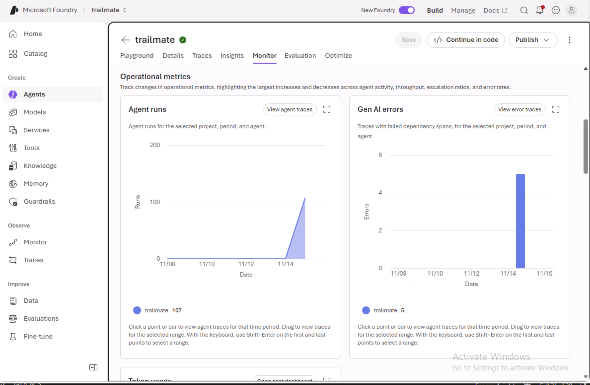
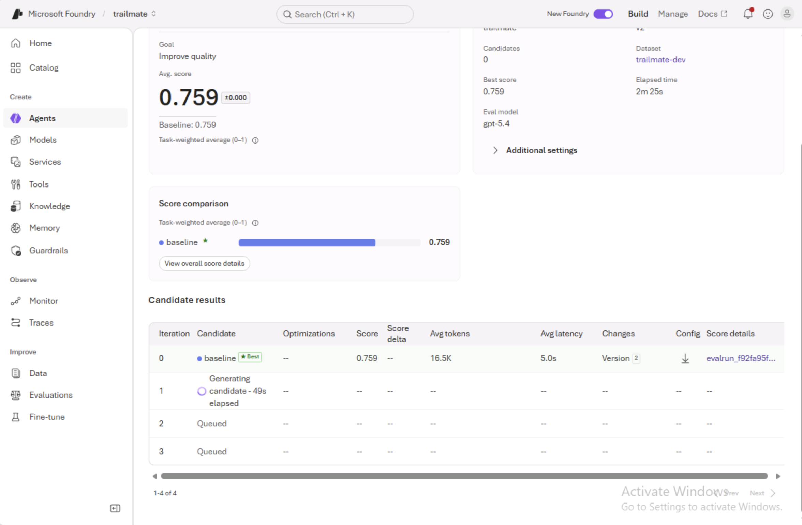

# 5.2 Check the monitor

**What we'll do:** Zoom out from one answer to all of them, then check on the optimizer.

1. [] On the trailmate agent page, open the **Monitor** tab. **Operational metrics** show the total token usage, our cost dial, across every run.

    

1. [] Scroll to the charts. **Agent runs** counts every conversation, including our practice questions and the optimizer's test runs. **Gen AI errors** shows any failed calls. Select **View agent traces** to jump to the traces behind a point.

    

1. [] Check on the optimizer. Select the **Optimize** tab and open our run. It first scores the baseline, our v1, then generates and scores candidates one at a time.

    

> [!Knowledge] Our agent works, but "works" isn't the same as "reliable". From here on we stop judging answers one at a time and start measuring them all.

> [+Hint] Ask Copilot: is the optimizer done?
>
> ++/microsoft-foundry What is the status of my latest agent optimization job for trailmate? Answer in one sentence. Do not change anything.++

---

> [!Note] **Success:** We just saw the whole agent at a glance and checked our optimizer is still climbing.
