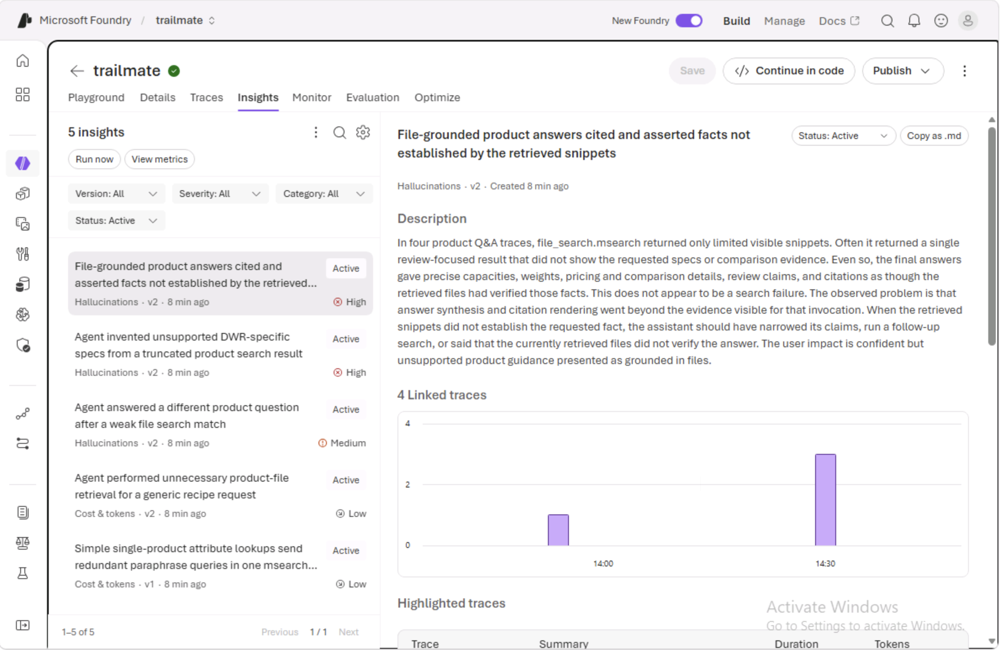
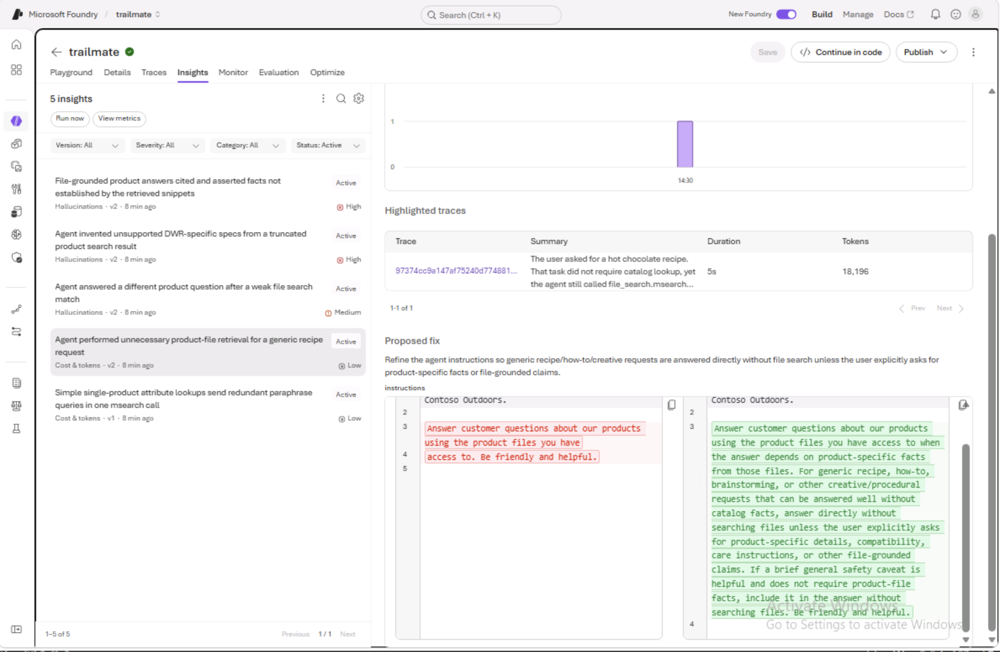

# 5.3 Read the insights

**What we'll do:** Read what Foundry found across TrailMate's traces, and check it against the three gaps we expected on page 3.2.

> [!Note] Insights come from your own traces, so yours will differ from ours. If a finding is hard to follow, use the **OPTIONAL - Ask Copilot** prompt at the end of this page to have it explained.

1. [] On the **trailmate** agent, open the **Insights** tab. The run we started on page 4.1 lists its findings, each with a category, a severity, and the agent version it was found in.

    

1. [] Select a **Hallucinations** finding and read its description. It explains the pattern and links to the traces that show it.
1. [] Select the finding about the **recipe request**, if your run has one, and scroll down. Under **Highlighted traces** is the hot chocolate conversation, and under **Proposed fix** is a suggested change to the instructions.

    

1. [] Compare the findings with our three gaps: overclaiming, making things up, and out of lane. Which did Foundry confirm? What did it see differently?

> [!Knowledge] In our test run, Foundry flagged the recipe as a **cost** problem: an unneeded file search. It didn't call it out of lane, because it doesn't know TrailMate's job. Your findings may differ. Insights give us evidence and a starting fix, and we still decide what "good" means. That's what our rubric in stage 6 is for.

> [+Hint] Still running? Read ours
>
> The screenshots on this page come from a completed run in our test. Read them now, and check yours again on page 6.1.

> [+Hint] OPTIONAL - Ask Copilot: which finding first?
>
> ++/microsoft-foundry Summarize the latest insights for my trailmate agent in three bullets. Which should we fix first? Do not change anything.++

---

> [!Note] **Success:** We just read Foundry's findings across every trace, saw a proposed fix, and checked our guesses against the evidence.
