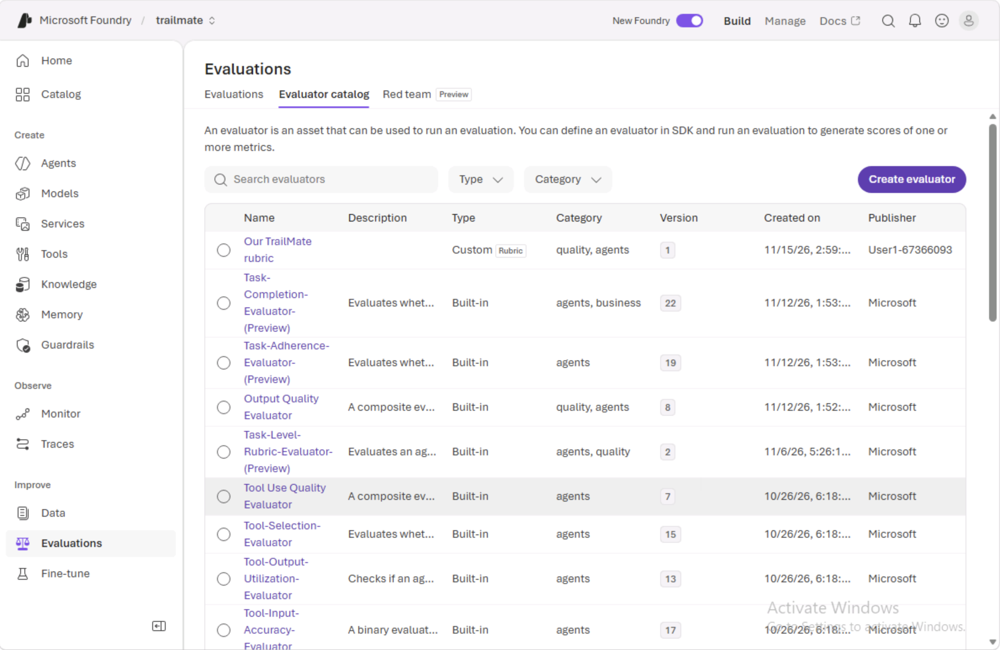
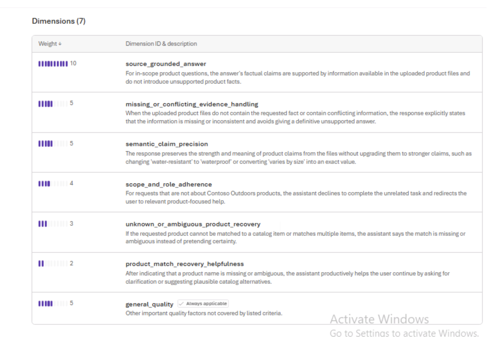

# 6.1 Turn good into a number

**What we'll do:** Read the rubric Foundry drafted from our traces and gaps, see how it connects to the insights, then use it to score **v0** and **v1** on the same questions.

1. [] Switch to **05-make-it-better.ipynb**. If the optimizer cell in section 5.6 is still running, click the **stop** button next to it.

    > [!Note] Stopping the cell only stops the notebook from waiting. The optimizer job keeps running in Foundry, and we'll pick it up again on page 6.2.

    <!-- VERIFY: interrupting the wait doesn't cancel the optimizer job -->

1. [] In the Foundry portal, open **Evaluations**, then the **Evaluator catalog** tab. **Our TrailMate rubric** is listed as a custom rubric, next to Microsoft's built-in evaluators.

    

1. [] Select **Our TrailMate rubric** and scroll to **Dimensions**. Each one is a weighted check the judge scores from 1 to 5.

    

1. [] Match the dimensions to what we've seen:
    - **source_grounded_answer** and **missing_or_conflicting_evidence_handling** cover the hallucination insights and our "making things up" gap.
    - **semantic_claim_precision** names our overclaiming gap: "water-resistant" becoming "waterproof".
    - **scope_and_role_adherence** says off-topic requests should be declined. The built-in evaluators and insights missed that the hot chocolate recipe was out of lane. Our rubric knows TrailMate's job.
1. [] Jump to section **5.5** and run its two code cells to score v0 and v1 twice each. It takes a few minutes.
1. [] Confirm the scoreboard has two rows, each with a score, a spread, and **errored** at 0.

    <!-- TODO screenshot: 06-better-01-scoreboard.png | The v0 and v1 scoreboard and the per-category table -->

> [+Hint] Ask Copilot: summarize the scores
>
> ++In three bullets, summarize what the rubric in section 5.3 of labs/core/05-make-it-better.ipynb checks and how v0 and v1 scored in section 5.5. Don't change any files.++

---

> [!Note] **Success:** We just turned "good" into a number, using a ruler we checked ourselves.
