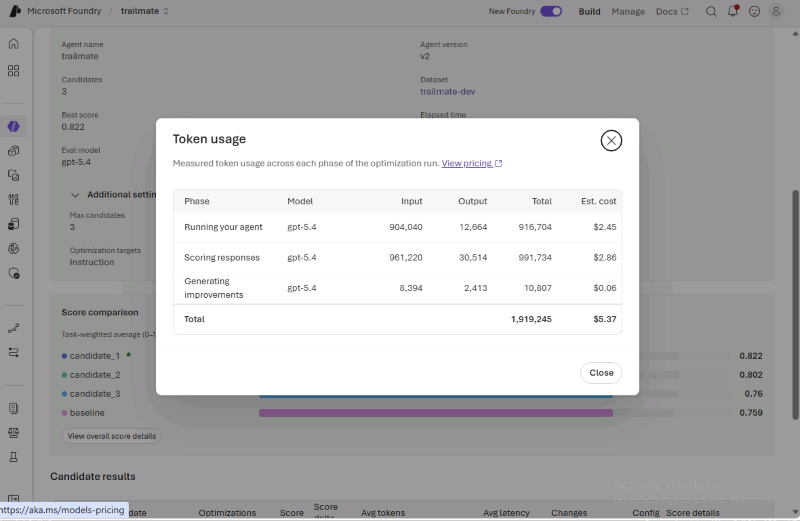

# 6.1 Read the optimizer results

**What we'll do:** See what the agent optimizer found: how each candidate scored with our rubric, what it changed, and what the run cost.

1. [] In the Foundry portal, open **trailmate**, select the **Optimize** tab, and open our run. When it finishes, **Candidate results** show each candidate's rubric score next to the baseline, agent Version 2, with average tokens and latency.

    

    > [!Note] Your results will differ. A different candidate may win, or none may beat the baseline. If none does, keeping Version 2 is the right decision. In our test, the run took about 10 minutes, and all three candidates beat the baseline of 0.759.

1. [] On the best candidate, select **View changes**. The short Version 2 instructions became a detailed set of rules, for example to only make claims the product files support.

    

1. [] Scroll up to **Run overview** and select **View details** next to **Total tokens**. It shows what the run itself cost, by phase.

    

    > [!Note] Our run used about 1.9 million tokens, an estimated $5.37, above the $4.88 ceiling estimated on page 3.2. Optimizing costs real money, so we check the measured cost, not just the estimate.

1. [] Recall the rubric dimensions from page 3.2. Your rubric may have different ones, so look for the same ideas:
    - Grounding dimensions, like **source_grounded_answer**, cover the hallucination insights from page 5.3.
    - A claim-precision dimension catches "water-resistant" becoming "waterproof".
    - A scope dimension says off-topic requests should be declined. The built-in evaluators passed the hot chocolate recipe, but our rubric knows TrailMate's job.

> [+Hint] I see "Ran into a deserialization error" in the notebook
>
> The optimizer cell in VS Code may print this Azure SDK warning. It tried to read a reply that had no body and ignored it. If the run finished on the **Optimize** tab, it's safe to ignore. If something else looks wrong, paste the message into Copilot Chat and ask what it means.

> [+Hint] OPTIONAL - Ask Copilot: what did the optimizer do?
>
> ++/microsoft-foundry Summarize my latest agent optimization run for trailmate in three bullets: the baseline score, the best candidate, and what it changed. Do not change anything.++

---

> [!Note] **Success:** We just read how the optimizer turned "good" into a score, which candidate won, and what it cost.
