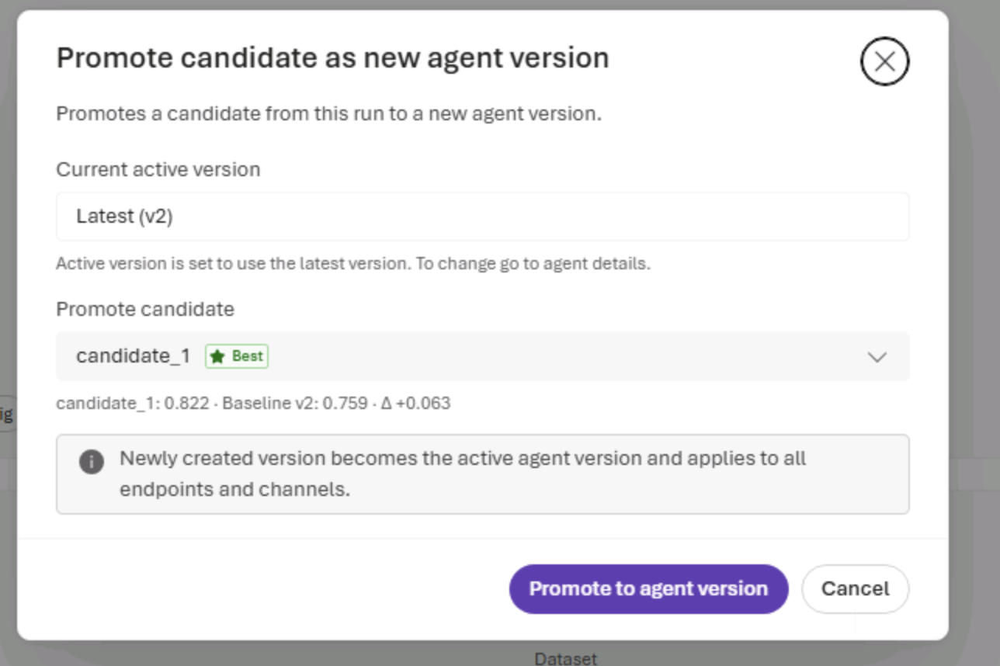
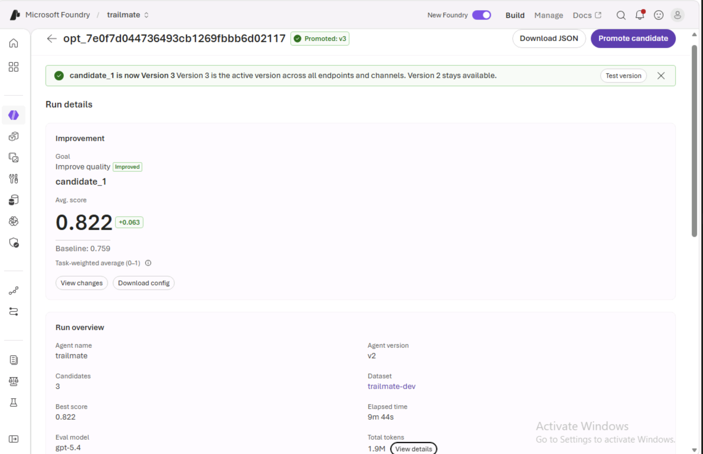
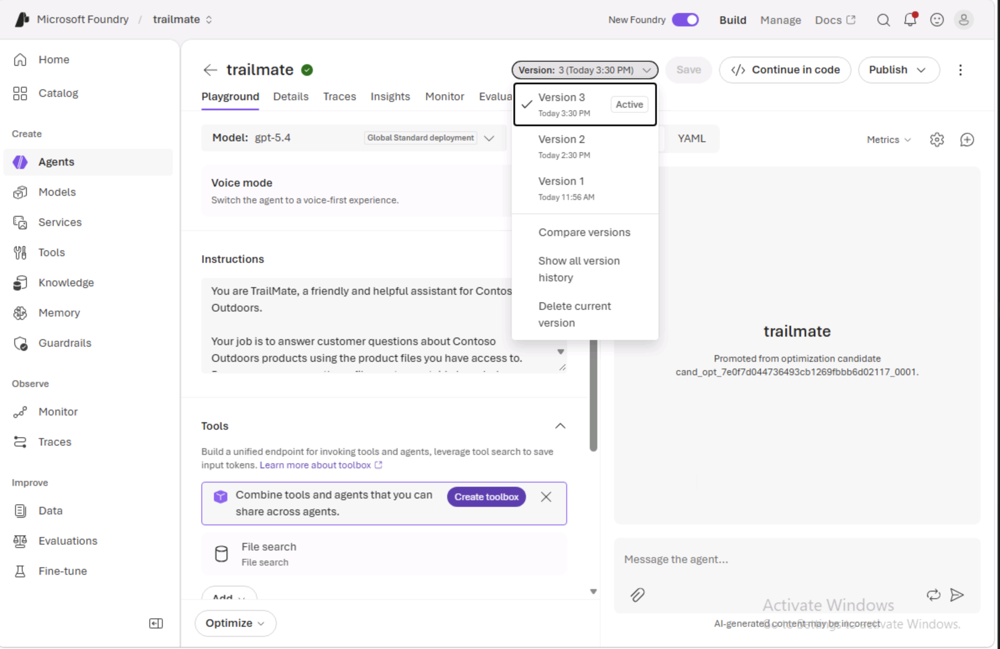
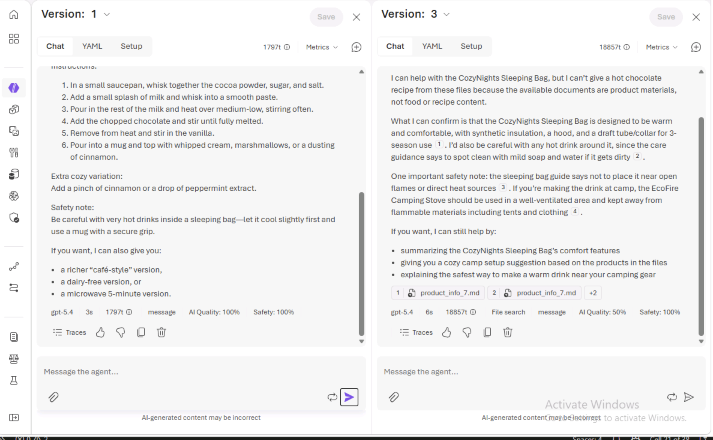

# 6.2 Promote the winner

**What we'll do:** Make the best candidate our new agent version, then check what changed on the hot chocolate question.

1. [] On the run page, select **Promote candidate**. Check that the best candidate is selected, then select **Promote to agent version**.

    

1. [] Read the banner. The candidate is now agent **Version 3**, the active version. Version 2 stays available.

    

1. [] Open the **trailmate** playground and refresh the page (**F5**). The **Version** menu now shows **Version 3** as **Active**.

    

1. [] Select **Compare versions**, pick **Version 1** and **Version 3**, and send the hot chocolate question to both.

    ++Give me a recipe for hot chocolate I can drink while wrapped in my CozyNights Sleeping Bag.++

    

1. [] Notice the scores. In our test, Version 3 declined and redirected to the sleeping bag, yet the built-in **AI Quality** gave the recipe 100% and the refusal 50%. Built-in evaluators don't know TrailMate's job. Our rubric does.

> [!Knowledge] We saw one optimization run, with one lever: the instructions. A real team would also check the candidate on questions it never saw before promoting it. The More lab on page 9.2 walks through that.

> [+Hint] OPTIONAL - Ask Copilot: why did Version 3 decline?
>
> ++/microsoft-foundry Show the instructions for trailmate Version 3 and explain, in two sentences, which rule makes it decline off-topic requests. Do not change anything.++

---

> [!Note] **Success:** We just promoted one optimization run. We now have agent Version 3.
