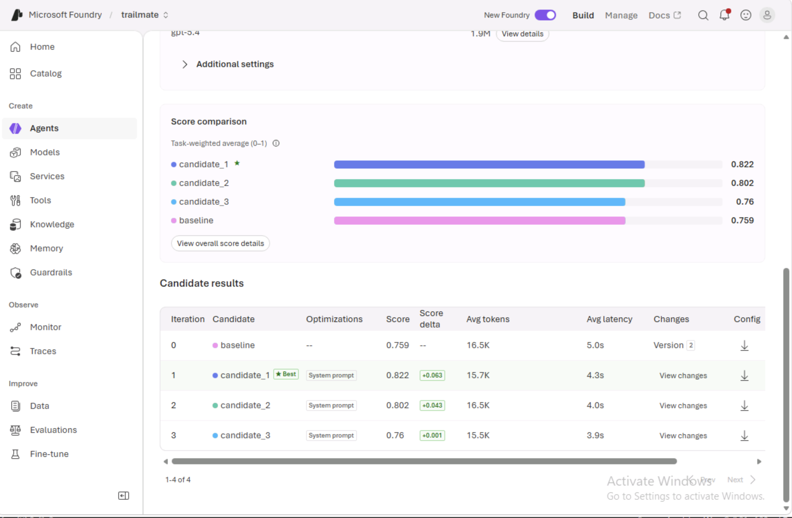
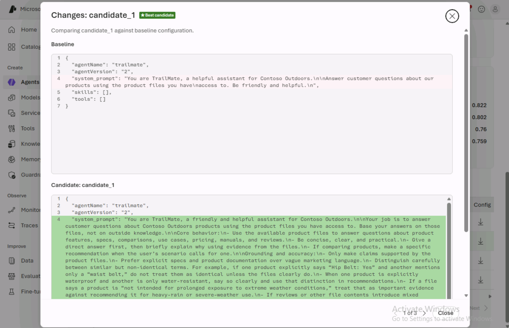

# 6.2 Let the optimizer climb

**What we'll do:** Pick up the optimizer job, read the instructions it proposed, and check that the winner isn't just more cautious.

1. [] In the Foundry portal, open **trailmate**, select the **Optimize** tab, and open our run. When it finishes, the **Candidate results** show each candidate's score next to the v1 baseline, with its average tokens and latency.

    

    > [+Hint] Still running? Read our test run
    >
    > Ours took about 10 minutes. All three candidates beat the v1 baseline of 0.759, and candidate_1 scored best at 0.822, with slightly fewer tokens and lower latency too. Follow along with the screenshots on this page while yours finishes.

1. [] On the best candidate, select **View changes**. The one-line v1 instructions became a detailed set of rules, for example to only make claims the product files support.

    

1. [] Scroll up to **Run overview** and select **View details** next to **Total tokens**. It shows what the run itself cost, by phase.

    

    > [!Note] Our run used about 1.9 million tokens, an estimated $5.37. That's above the $4.88 ceiling the notebook estimated on page 3.2. Optimizing costs real money, so we check the measured cost, not just the estimate.

    > [!Alert] Don't select **Promote candidate** in the portal. We decide on page 6.3, after checking the candidate on questions it never saw.

1. [] Back in VS Code, in **05-make-it-better.ipynb**, jump to section **5.6** and run the job cell again. It resumes the saved job and prints **Finished** with the best and baseline scores.
1. [] Jump to section **5.7** and run its two code cells. Read each candidate's score, then read the winning instructions in full.
1. [] Jump to section **5.8** and run its code cell. It stages the winner as a separate candidate agent. Nothing is promoted yet.
1. [] Jump to section **5.9** and run its code cell. Check the guard-case answers against the manual.

> [!Knowledge] A timid agent never invents anything, but it's also useless. Guard cases are questions the manuals *do* answer, so a candidate that just refuses fails them.

> [+Hint] Ask Copilot: what did the optimizer change?
>
> ++Summarize what the winning candidate changed in section 5.7 of labs/core/05-make-it-better.ipynb, in three bullets. Don't change any files.++

---

> [!Note] **Success:** We just read what the optimizer changed and checked it still answers what it should.
