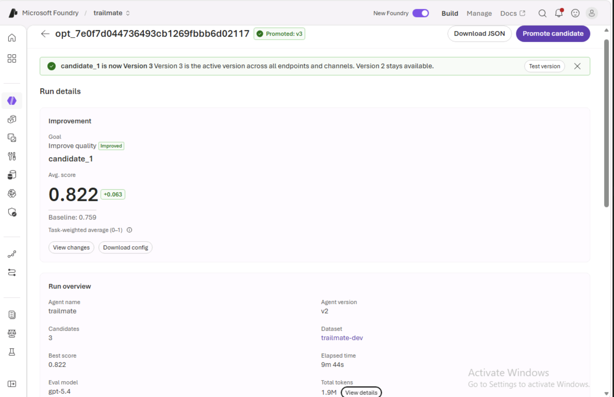
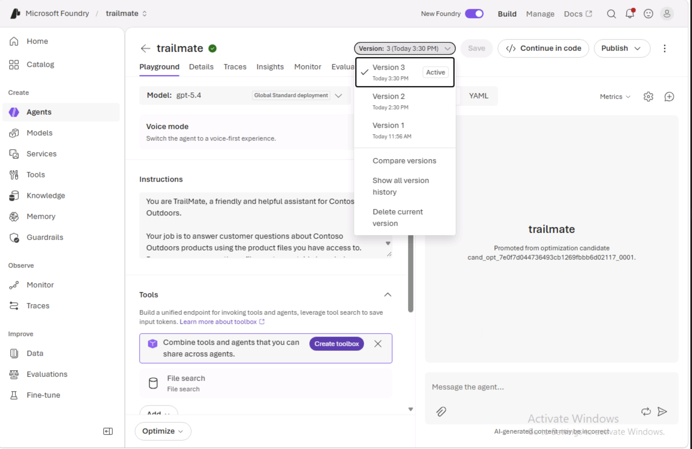
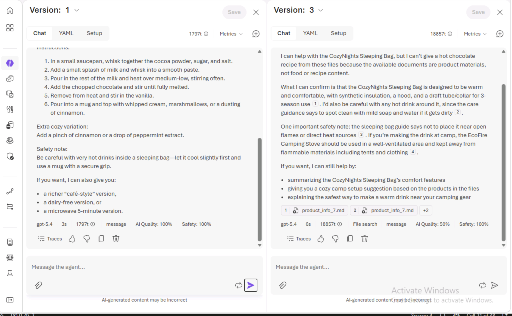

# 6.3 Decide whether to promote

**What we'll do:** Test v0, v1, and the candidate on questions the optimizer never saw, then make an explicit promote-or-retain decision for **v2**.

1. [] Jump to section **5.10** and run its two code cells. It takes a few minutes. Confirm the board has rows for v0, v1, and the v2 candidate.
1. [] Run section **5.11** and compare the gain on questions the optimizer trained on with the gain on questions it never saw.

    <!-- TODO screenshot: 06-better-03-heldout.png | Section 5.11 comparing dev gain with test gain -->

1. [] In section **5.12**, set `REVIEW_APPROVED = True` only if the instructions, guard answers, and scores hold up. Then run the cell and read the decision.

    > [+Hint] What does promotion do?
    >
    > Promotion turns the candidate into a new **trailmate** agent version and makes it active. In our test, the candidate became **Version 3**, our climb version **v2**, and the portal confirmed it. The notebook promotes the same way, but only after the checks pass.
    >
    > 

1. [] If the candidate was promoted, open **trailmate** in the portal. The **Version** menu now shows the new version as **Active**.

    

1. [] Select **Compare versions**, pick **Version 1** and the new version, and send the hot chocolate question to both.

    ++Give me a recipe for hot chocolate I can drink while wrapped in my CozyNights Sleeping Bag.++

    

1. [] Notice the scores. In our test, the built-in **AI Quality** gave the recipe 100% and the correct refusal 50%. Built-in evaluators don't know TrailMate's job. Our rubric does, and that's why we measure with it.

> [!Knowledge] The gain on trained questions is the gain the optimizer wanted. The gain on unseen questions is the gain we can trust. If the candidate doesn't pass, keeping v1 as our v2 checkpoint is a correct result, and the comparison steps above don't apply.

> [+Hint] Ask Copilot: explain the decision
>
> ++Explain the decision printed in section 5.12 of labs/core/05-make-it-better.ipynb in two sentences: was the candidate promoted, and why? Don't change any files.++

---

> [!Note] **Success:** We just made a promote-or-retain decision backed by evidence, not by a single score.
