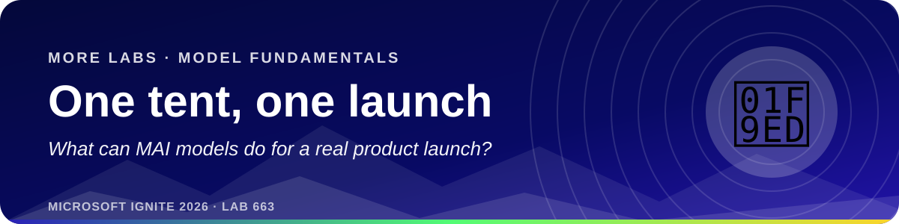
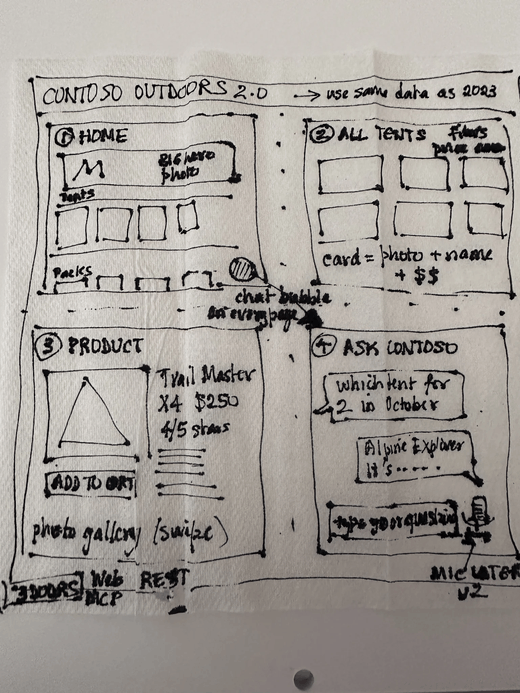
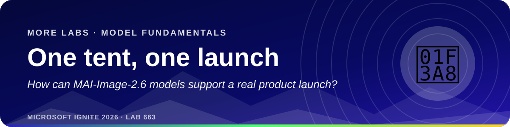
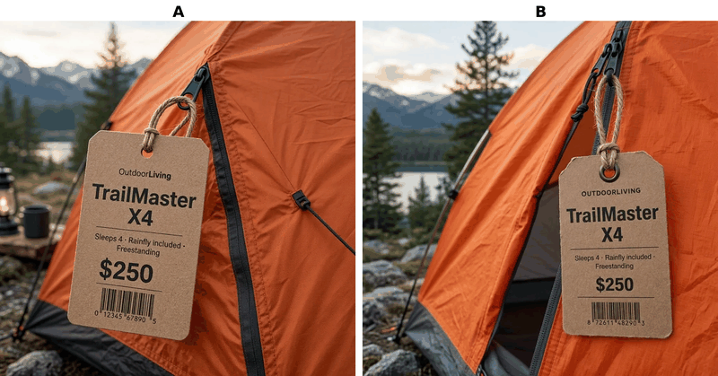

# 9.1 More: explore MAI models

**What we'll do:** Follow one product launch through four Microsoft AI (MAI) model families, look at what each one made, and decide which jobs need the bigger model. This lab is optional.

## 9.1.1 Set the stage

In the core lab we improved TrailMate, Contoso Outdoors' support agent. The rest of the business has work too: marketing is relaunching the **TrailMaster X4** tent, and the website TrailMate lives on needs a refresh.

1. [] In the VS Code Explorer, open **labs > more > 00-set-the-stage.ipynb**.
1. [] Click **Select Kernel**, then **Python Environments**, and pick **.venv (3.13.14)**, the same way as on page 1.3. We do this for every notebook in this lab.
1. [] Read sections **0.1** to **0.5**. There's nothing to run yet.
1. [] In section **0.4**, find the napkin sketch the web team drew for the new store.

    

    > [!Knowledge] **Think about it:** can you read every word on the napkin? A model will struggle with the same smudges. In notebook 04, we ask it to tell us what it *couldn't* read instead of guessing.

---

## 9.1.2 One launch, four models

A launch is many separate jobs, and each job needs a different kind of model. Each notebook gives one job to one MAI model family:

| Notebook | Model | The job | Why this model |
|:---------|:------|:--------|:---------------|
| **01** Build the launch kit | MAI-Image-2.6 and MAI-Image-2.6-Flash | Posters, catalog pages, close-ups, edits | Image models used to mangle words on pictures. This one is built to spell headlines and prices correctly |
| **02** Give it a voice | MAI-Voice-2.1 and MAI-Voice-2.1-Flash | A radio ad, a hotline voice, a setup guide read aloud | Turns our text into natural speech, with different moods and languages |
| **03** Hear your customers | MAI-Transcribe-2 | Checks the radio ad, makes calls searchable, writes captions | Turns speech back into text, so we can check what notebook 02 actually said |
| **04** Refresh the storefront | The latest MAI-Code Flash model, in GitHub Copilot | Turns the napkin into a website | A coding model inside the editor we already use |

The notebooks tell one story in order: the pictures from 01 become the radio ad in 02, 03 checks the ad, and 04 puts it all on the new launch page.

> [!Knowledge] Most MAI models come in two versions. **Flash** does the same job faster and for less money; the standard model aims for the best result. That's the question the model router answered for us in the core lab: *which jobs actually need the big model?* Here, we answer it ourselves by comparing both versions on the same job.

---

## 9.1.3 Read the saved results

Every More notebook comes pre-run. The setting `DEMO_MODE` defaults to `replay`, so when we open a notebook we see our team's saved results. Reading them needs no Azure and costs nothing.

1. [] Open **labs > more > 01-build-launch-kit.ipynb** and select the kernel.

    

1. [] Jump to section **1.5**, a launch poster made from one prompt.

    

    > [!Knowledge] **Think about it:** the poster has five pieces of text. How many are spelled exactly right? Check the price and the footer too.

1. [] Jump to section **1.8**, one catalog page with four colors of the same tent.

    

    > [!Knowledge] **Think about it:** what drifts between the panels: the shape, the logo, or the labels? For a catalog of hundreds of colors, would you generate each one, or edit one approved picture?

1. [] Jump to section **1.16.1**, the blind taste test. Both models drew the same prompt.

    

    > [!Knowledge] **Think about it:** which one is Flash? Would a customer notice the difference on a phone screen? On a billboard?

    > [+Hint] Show the answer
    >
    > **A** is MAI-Image-2.6-Flash and **B** is MAI-Image-2.6. If it was hard to tell, that's the point: for drafts and volume, Flash is often good enough. Section **1.16.3** shows a pattern that uses both: draft on Flash, then finish the favorite on MAI-Image-2.6.

1. [] Open **02-give-it-a-voice.ipynb** and find the radio ad in section **2.5**, then the three moods in **2.6**. Each one shows an audio player and the script it read.

    

    > [!Alert] The lab virtual machine has no sound, so we can see the audio players but can't hear them. Come back to notebook 02 at home to listen. The audio is saved inside the notebook, so it plays straight away, with no Azure needed.

    > [!Knowledge] **Think about it:** on a support hotline, a caller is waiting. Is that a job for the standard voice or for Flash?

1. [] Open **03-hear-your-customers.ipynb** and read section **3.5**, where the radio ad is transcribed and checked against the script.

    

    > [!Knowledge] **Think about it:** names like *TrailMaster X4* are easy to mishear. Section **3.6** shows how to teach the model our spelling.

1. [] Open **04-refresh-the-storefront.ipynb** and read section **4.5**, where a coding model reads the napkin.

    

    > [!Knowledge] **Think about it:** section **4.6** asks us to fix and approve the model's reading before it writes any code. Why is that step worth the time?

---

## 9.1.4 Run it yourself (optional)

Live runs call the models, so they cost money and take longer. Notebook 01 takes 15 to 45 minutes, mostly waiting on rate limits. Run them here only if we finish early, or later with our own subscription.

1. [] In VS Code, select **Terminal > New Terminal**, then install the extra packages these notebooks need:

    +++.\.venv\Scripts\python.exe -m pip install -r labs\more\requirements.txt+++

    The output ends with **Successfully installed** or **Requirement already satisfied**.

1. [] In the Explorer, open the **.env** file at the top of the **LAB663** folder. Find the `DEMO_MODE` line, or add one at the end, and set it to live. Save the file.

    ++DEMO_MODE=live++

1. [] In **01-build-launch-kit.ipynb**, click **Restart** in the notebook toolbar, then **Run All**. In section **1.4**, the setup cell prints **Mode: 🎨 live**. Our own pictures are saved under **labs/more/output**.
1. [] When we're done, set the line back to `DEMO_MODE=replay`. Replay mode now shows our pictures first, then the saved examples.

> [!Note] Speech access for notebooks 02 and 03 hasn't been checked in this lab environment. If a voice or transcription cell returns a 401 or 403 error, read the saved results instead. Notebook 04 builds the site with GitHub Copilot Chat, so we follow its prompts instead of using Run All.

> [+Hint] OPTIONAL - Ask Copilot: what are MAI models?
>
> ++What are Microsoft AI models? Explain the MAI models covered in these labs.++

---

> [!Note] **Success:** We just followed one launch through four MAI model families and decided which jobs need the bigger model.
